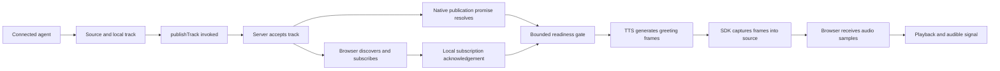

# Phase 1R — Real-time voice latency: measurement and evidence-based tuning

## Outcome and verification boundary

- Dialog now has a repeatable, stage-by-stage latency benchmark for the LiveKit voice path, bounded per-stage metrics in the worker, and a fail-closed manual-live profile for real providers.
- **All numbers in this document are mock-provider results** from a local Windows/WSL2 Docker host. They measure Dialog's orchestration, LiveKit room media and the official SDK plugins against deterministic fixtures. They say nothing about real Deepgram, Sarvam or LLM latency, network distance to providers, telephone (SIP) audio, or capacity. Do not quote them as production call latency.
- **Manual-live did not run.** No operator credential files (`.local/livekit/manual-*.env`) or recorded speech clip exist on this machine. The profile is implemented and its preflight was verified to fail before any network request.
- SIP/Vobiz/Contabo were out of scope: nothing was deployed, provisioned or called.
- Net configuration change after evidence: **turn-taking defaults are unchanged from the baseline.** Every tuning experiment that reduced latency also introduced a quality regression (split turns or stalled first turns). The shipped changes are correctness, accounting and observability changes plus one deliberate latency-for-quality trade-off (the sentence tokenizer).

## Stage definitions

Each interval is measured on a single monotonic clock: browser intervals use the page's `performance.now()`, worker intervals use the job process's `performance.now()`. The two clock domains are never subtracted from each other.

| Metric | Clock | From → to |
| --- | --- | --- |
| `browser.connectToGreetingMs` | browser | room connected → first greeting audio (includes job dispatch, worker process availability, claim, greeting synthesis) |
| `browser.e2eFirstAudioMs` | browser | synthetic user speech ends at the source → first agent audio above threshold in the subscribed track |
| `browser.playbackMs`, `browser.gaps` | browser | reply onset → last audible sample; 30–400 ms silent gaps inside a reply (each one is starvation; mock TTS is a continuous tone) |
| `browser.interruptStopMs` | browser | interrupting speech starts → last audible sample of the obsolete reply |
| `worker.sttFirstInterimMs` | worker | VAD user speaking → first STT transcript event |
| `worker.endOfTurnDelayMs` | worker (SDK metric) | end of user speech → turn committed |
| `worker.finalToLlmFirstTokenMs` | worker | last final transcript before the request → first LLM text chunk (includes the commit wait) |
| `worker.llmFirstTokenMs` | worker | LLM request start → first text chunk (worker → Dialog API hop included) |
| `worker.llmFirstToTtsAudioMs` | worker | first LLM text → first synthesized audio frame |
| `worker.ttsAuthorizeMs` | worker | TTS node start → Dialog operation admission granted |
| `worker.ttsFirstAudioMs` | worker | admission granted → first audio frame (connect, tokenization, synthesis) |
| `worker.eouToAgentSpeakingMs` | worker | turn committed → agent state speaking (playout started) |
| `worker.bargeToAgentListeningMs` | worker | VAD detects barge-in → agent listening (playout paused or interrupted) |
| `worker.ttsNoAudioGiveUpMs` | worker | (fault cases) admission → TTS stream ended without any audio |

Percentiles: p50 requires ≥ 5 samples, p90 ≥ 10, p95 ≥ 20. Below that the value is reported as unavailable, never as zero. Failures are counted per case and are not dropped from the report.

## Method

- **Path:** headless Chromium (synthetic microphone) ↔ local LiveKit server ↔ Dialog worker (`@livekit/agents` 1.9.3 with the official Deepgram, Sarvam and Silero 1.9.3 plugins) ↔ Dialog fixture API (claims, admission, usage, LLM route) ↔ deterministic mock STT/LLM/TTS.
- **Synthetic speech:** formant-synthesized voice (Silero max speech probability 0.995; an earlier sawtooth source scored 0.071 and was rejected because VAD did not treat it as speech).
- **Mock LLM** streams word-sized chunks every 20 ms. That pacing is a fixture constant, not a model estimate.
- **Cases** (per mixed session): `pause` (1.5 s speech, 450 ms pause, 1.5 s speech; one turn expected), `long` (3 s speech, long reply), `silence` (2 s of silence first; no reply may start), `interrupt` (barge-in 1.2 s into the reply), `false_interrupt` (250 ms burst 1.2 s into the reply). Repeat sessions run six `short` turns (1.2 s speech). Fault runs inject `tts_refuse`, `tts_stall` and `stt_drop`.
- **Default run:** 1 warm-up session (discarded), 10 mixed sessions, 4 repeat sessions × 6 turns, 2 runs per fault. About 25 minutes.
- **Report:** `.local/livekit/bench/<label>-<timestamp>.json` and `.md`, with environment (Node, Chromium, platform, CPUs, memory), configuration (tuning, iterations, mode), definitions, mock provider counters, aggregates and per-turn records. No credentials, identities, phone numbers, transcripts or audio are written. Manual-live reports drop per-turn records entirely.
- **Environment for all runs below:** Node v24.22.1, Chromium 156, Linux 6.6 (WSL2), Docker VM with 4 CPUs and 4 GB RAM shared by Chromium, LiveKit, Postgres, Vite, the API, the worker and its job processes.

## Results: baseline vs after (mock, same benchmark, same tuning)

Runs: `baseline-2026-10-23T05-11-16-321Z` (code before Phase 1R changes) and `after-final-2026-10-23T06-51-40-781Z` (final code and defaults). Full table: `node scripts/voice-bench-compare.mjs <before.json> <after.json>`.

### Short turns (repeat sessions; n = 24 each)

| Metric | p50 before → after | p90 before → after | p95 before → after |
| --- | --- | --- | --- |
| End of speech → first audio (browser) | 1362 → 1215 ms (−147, −10.8%) | 1794 → 1518 (−15.4%) | 1814 → 1622 (−10.6%) |
| First STT interim | 200 → 211 | 261 → 236 | 266 → 240 |
| End-of-turn delay (SDK) | 501 → 500 | 503 → 502 | 505 → 502 |
| Final transcript → first LLM token | 563 → 546 | 637 → 572 | 643 → 598 |
| LLM first token | 55 → 42 | 121 → 61 | 123 → 84 |
| First LLM text → first TTS audio | 173 → 148 | 245 → 188 | 319 → 239 |
| TTS admission | 24 → 13 | 94 → 30 | 119 → 187 |
| TTS first audio | 135 → 134 | 201 → 144 | 224 → 148 |
| Turn committed → agent speaking | 225 → 192 | 353 → 237 | 446 → 330 |

Outcomes: 24/24 ok in both runs.

**Interpretation.** No Phase 1R code change sits on the mock short-turn path in a way that explains these reductions: tuning is identical, the parallelized LLM-route reads only run in live mode, and the new tokenizer emits the same first sentence for the short reply. Treat the short-turn deltas as run-to-run variance on a shared, contended host, not as an optimization result. The dominant fixed costs are visible and unchanged: ~500 ms endpointing delay plus ~200 ms of STT chunking/interim latency before the LLM is even asked.

### Mixed cases (n ≤ 10; p90/p95 mostly unavailable)

| Case | Outcomes before | Outcomes after | Notable p50 change |
| --- | --- | --- | --- |
| pause | 7 ok, 3 duplicate reply | 8 ok, 2 timeout | duplicates gone; e2e 1310 → 919 ms (n 10 → 8) |
| long | 10 ok | 9 ok, 1 timeout | **TTS first audio 117 → 263 ms** (tokenizer, see trade-offs) |
| silence | 8 ok, 1 timeout, 1 reply during silence | same | — |
| interrupt | 10 ok | 9 ok, 1 timeout | stop 1016 → 839 ms; barge → listening 468 → 452 ms |
| false_interrupt | 9 treated as new turn, 1 timeout | 8 treated as new turn, 2 timeout | unchanged behaviour (see findings) |
| session start | 11 ok, 3 ok after retry | 13 ok, 1 ok after retry | connect → greeting p50 2174 → 1242, p90 5196 → 6976 |

The after-run timeouts are concentrated: session 5 went silent after its first turn (5 of the 7 mixed timeouts), and session 4's first turn stalled with its reply leaking into the silence case. See "Open issue: first-turn stalls".

### Fault cases (n = 2 each; no percentiles)

| Fault | Before | After |
| --- | --- | --- |
| TTS refuses connection | both runs lost the greeting (not measurable) | turn dropped in ~15 ms, next turn recovered (2/2), work settled as `unknown` |
| TTS stalls (no audio) | 1 lost greeting, 1 dropped at 10.0 s then recovered | dropped at 10.0 s (SDK `ttsReadIdleTimeout`), recovered 2/2 |
| STT socket drop | 1 recovered, 1 no recovery | 1 delivered, 1 no recovery |

Fault-run baselines are partly contaminated by slow job-process start-up, so they are evidence of behaviour, not a latency comparison.

## Experiments and decisions

All experiments ran the same benchmark on the new code with one variable changed.

| Experiment | Evidence | Decision |
| --- | --- | --- |
| `endpointingMinMs` 500 → 200 | pause case split in 4 of 5 (duplicate replies), 1 premature reply in short turns | **Rejected** |
| Preemptive LLM generation off | ~20 ms lower final-to-first-token, one LLM call per pause turn; but in a 36-turn A/B against "on" (same code, same host, back to back) 27/36 vs 35/36 short turns ok, with the first user turn stalling in 3 of 6 sessions; across all runs, first-turn stall or dead session in 4 of 10 repeat sessions with it off vs 0 of 10 with it on | **Rejected; baseline (on) kept.** Available as `DIALOG_VOICE_PREEMPTIVE_LLM=off` for further investigation |
| Preemptive TTS | not enabled: speculative synthesis is billable and the spec forbids it by default | Not run |
| Model substitution | out of scope by rule | Not run |

The initial "preemptive off" experiment (2 repeat sessions) looked clean and was briefly adopted; the larger A/B reversed it. This is why the comparison requirements insist on sample counts.

## Changes shipped in Phase 1R

1. **Benchmark harness** (`scripts/voice-smoke.mjs` with `VOICE_BENCH=1`; `pnpm voice:local:bench`), comparison script (`scripts/voice-bench-compare.mjs`; `pnpm voice:local:bench:compare <before> <after>`), refusing to compare mock with manual-live reports.
2. **Stage instrumentation** (`artifacts/livekit-agent/src/bench.ts`): fixed event names, numeric fields only, published to the room for the local harness and aggregated into `dialog_voice_stage_duration_seconds{stage,provider,mode,outcome}`. All labels are closed sets; unknown labels and out-of-range values are dropped.
3. **Dialog sentence tokenizer** (`artifacts/livekit-agent/src/sentences.ts`) for Sarvam streaming TTS: no sentence break inside URLs, decimals, dates, `Rs. 1,250`, `No. 4`, titles (`Dr.`, `Shri`, …), initials or `p.m.`; Hindi `।`/`॥` are boundaries (the plugin default tokenizer did not split Devanagari text until the end of the reply).
4. **TTS settlement:** a stream that completes with text sent but no audio is now settled as `unknown` (reconcile later), not `charged`; cancelled work stays billable/unknown and is never released as free.
5. **LLM stream decoding:** one `TextDecoder` per stream so multi-byte (Devanagari) characters split across network chunks are not corrupted.
6. **LLM route** (`artifacts/api-server/src/lib/livekit/llm-stream.ts`): scripts, knowledge and rate-card reads run concurrently before the provider request (live mode only; not measurable in mock). Billing order and per-chunk claim revalidation are unchanged; revalidation costs an estimated ~5 ms per chunk and is kept for revocation safety.
7. **Configurable, validated tuning** (`DIALOG_VOICE_STT_ENDPOINTING_MS`, `DIALOG_VOICE_ENDPOINTING_MIN_MS`, `DIALOG_VOICE_ENDPOINTING_MAX_MS`, `DIALOG_VOICE_PREEMPTIVE_LLM=on|off`, `DIALOG_VOICE_TTS_IDLE_TIMEOUT_MS`). Invalid values stop the worker at start-up without echoing the value. Defaults equal the baseline.
8. **Process readiness log** (`livekit_process_ready` with VAD load time and uptime) to diagnose slow job start.
9. **Manual-live profile** (`pnpm voice:local:bench:live`), described below.

## Trade-offs

- **Tokenizer: correctness over ~120–150 ms on some long replies.** The old tokenizer sent "Your order total is Rs." to TTS after 6 words; the Dialog tokenizer waits for "…Rs. 1,250.50 and it ships on 12.05.2026." (12 words). At the mock's 20 ms/word that is +120 ms predicted, +146 ms measured on TTS first audio for the long/interrupt/false-interrupt replies. Splitting at abbreviations causes Sarvam to synthesize a sentence-final intonation mid-amount and can break URLs; for Hindi the new tokenizer starts synthesis much earlier (word 5 vs end of reply in offline tests). Real LLM token pacing differs, so the live cost must be measured.
- **Preemptive generation stays on:** it costs extra (billable) LLM requests when a turn is split, in exchange for avoiding the first-turn stall observed with it off.
- **Endpointing stays at 500 ms min delay:** it is the largest single controllable latency, but 200 ms split natural mid-sentence pauses.
- **TTS idle timeout stays 10 s:** lower values would drop a stalled reply sooner but real Sarvam inter-chunk gaps are unmeasured; tune only with manual-live evidence.

## Provider and SDK findings

- **Sarvam plugin (1.9.3):** if the socket closes before the `final` event, the stream ends normally with no error (the reply is silently truncated); a refused connection raises an error but the plugin does not retry. It exposes no `min_buffer_size`/`max_chunk_length` options, so these were not changed. Voice, language, model (`bulbul:v3`), `linear16` at 24 kHz are preserved.
- **Deepgram plugin (1.9.3):** audio is resampled by the SDK from the 48 kHz room track to 16 kHz and sent in 100 ms chunks; the first interim therefore lands ~200 ms after speech onset even with an instant mock.
- **SDK turn handling (1.9.3, STT turn detection):** preemptive generation on a final transcript requires the turn to be committed or VAD-based detection, so it rarely fires for single-segment turns. Interruption by audio needs ≥ 500 ms of VAD speech; with false-interruption resume, the SDK pauses playout and sets the agent to listening. A 250 ms burst during a reply was treated as a new user turn in 8–9 of 10 runs (the obsolete reply is replaced, not resumed). This behaviour is unchanged by Phase 1R and should be revisited with real speech.
- **Audio conversion:** the worker contains no custom resampling or transcoding; conversions happen inside the SDK, plugins and LiveKit (Opus). Nothing Dialog-owned was found worth replacing, so nothing was changed. The Twilio media-stream path is untouched.

## Phase 1R-F — local voice reliability remediation

**Verification boundary:** everything in this section is mock-provider / local-media verification (headless Chromium ↔ local LiveKit ↔ Dialog worker on a 4-CPU / 4 GB WSL2 Docker VM, deterministic mock STT/LLM/TTS, synthetic formant voice). It is not production reliability evidence.

### Root causes (with evidence)

Phase 1R's "silent sessions and first-turn stalls" were three separate mechanisms, all triggered or amplified by CPU contention. With the host's `pnpm run dev` stopped and no added load, none of them reproduced in 30 first-turn sessions. They were reproduced deliberately with a controlled load container (`--cpus 3.5`, four busy loops) inside the Docker VM.

1. **A single failed heartbeat killed a healthy session (code defect, fixed).** The worker closed the session on the first heartbeat error. Under starvation a renewal request times out client-side (after a stall, Node's timer phase runs before pending socket reads), even though the server never refused it. Evidence: the worker logged close reason `heartbeat` while the API logged no `livekit_request_denied` for the heartbeat route in that window. When it happened during start-up the greeting never played. This matches Phase 1R's silent sessions, which followed ~10 s freezes.
2. **User speech during the greeting is discarded by the SDK (SDK behaviour, default kept).** `@livekit/agents` 1.9.3 runs an echo-cancellation warm-up (`aecWarmupDuration`, default 3000 ms; none for outbound SIP). While the agent is speaking inside that window the SDK replaces STT input with silence and ignores interruptions. Under contention the worker's playout lags what the browser hears, so a user who starts 150–600 ms after hearing the greeting end is still "talking over the greeting" from the worker's point of view. Evidence: in failing turns VAD reported `user_speaking` but the mock STT received **0 loud frames** for the whole utterance (normal turns: 13–14), and the next turn's counters were normal (speech was dropped, not delayed). With `DIALOG_VOICE_AEC_WARMUP_MS=0` the STT received the speech in every turn (0 of 58 turns lost vs 3 of 42 with the default). The default is kept because the echo risk of disabling it cannot be measured with mock media; the setting is now configurable.
3. **Agent audio track publication occasionally never completes (unconfirmed; outstanding).** In 1 of 30 uncontended sessions, 3 of 30 contended sessions and 2 of 9 post-restart sessions, the greeting was synthesized (`tts_first_audio`, `tts_end`) but neither `agent_track_published` nor `agent_track_subscribed` was emitted within 20 s. The SDK holds all agent audio until the participant subscribes. The stall is inside rtc-node `publishTrack` / LiveKit publisher negotiation. LiveKit server warnings (`udp_mux ... closed pipe`) occur only at session teardown and do not coincide. A fresh session always succeeded. The root cause is **not confirmed**.

Also observed, not fixed: after a cold worker restart, the first job's replacement idle process took 24.9 s to become ready (normal 1.1–7.7 s), and the event-loop stalls let one session's lease lapse (`heartbeat` close; correct, since the lease had expired). It happened in 1 of 4 restart runs. The single-sample premature reply in the uncontended run (150 ms gap) was a mock STT final 390 ms into a 1200 ms utterance; it did not recur.

### Changes and trade-offs

- **Heartbeat renewal** (`artifacts/livekit-agent/src/agent.ts`, `api.ts`): only a 4xx answer from Dialog ends the session. Timeouts, transport errors and 5xx retry every 250 ms until the lease could have lapsed (renewal send time + 15 s; the claim send time for the first renewal). Renewal requests time out after 4 s instead of 8 s, so a hung request leaves room to retry inside the lease. No server check changed: Dialog still rejects every request once `lease_until` has passed, `reconcile()` still closes lapsed sessions, and a test pins that a lapsed lease answers 403. Trade-off: a worker that has silently lost its lease can keep its media path up for at most the remaining lease time (< 15 s), and every paid operation in that window is still refused server-side.
- **AEC warm-up configurable** (`voice-tuning.ts`): `DIALOG_VOICE_AEC_WARMUP_MS` (0–3000; 0 disables). Unset keeps the SDK's participant-aware default. An explicit value also overrides the outbound-SIP exemption, which is why the default passes nothing.
- **Bounded diagnostics** (worker clock, names and numbers only): `loop_stall`, `heartbeat_late`, `heartbeat_retry`, `heartbeat_lost` (HTTP status or 0, ms since last renewal), `greeting_done`, `agent_track_published`, `agent_track_subscribed`, `session_end` with a closed set of reasons. The worker logs `livekit_session_closed` with its reason. The API logs the route template (never IDs) on denials and the count of expired sessions closed by reconciliation.
- **Benchmark** (`scripts/voice-smoke.mjs`): `VOICE_BENCH_FIRST_TURN=N` runs first-turn sessions that speak 150, 600 or 1500 ms after the greeting ends, then a second turn. Each records session diagnostics and mock STT counter deltas. Silent sessions are classified (`timeout_session_silent`). Mixed and repeat sessions now carry diagnostics and duration. A failed smoke turn prints the worker stage timeline and counter deltas.

Endpointing and preemptive defaults are unchanged.

### Repeated-session results

| Run | Load | Sessions (retries) | Premature closes | First turn ok | Second turn ok |
| --- | --- | --- | --- | --- | --- |
| Before fix | none | 30 (0) | 0 | 29/30 | 30/30 |
| Before fix | 3.5 CPUs | 15 (2) | 1 heartbeat | 14/15 | 15/15 |
| Heartbeat fix | 3.5 CPUs | 30 (3) | 0 | 25/30 | 29/30 |
| Heartbeat fix + STT counters | 3.5 CPUs | 21 (1) | 0 | 17/21 | 21/21 |
| Warm-up disabled (experiment) | 3.5 CPUs, heavier host load | 30 (3 + 1 failed) | 1 heartbeat (15.1 s freeze > lease) | 14/29 | 21/29 |
| **After (shipped defaults)** | none | 30 (1) | 0 | 29/30 | 30/30 |

How to read the rows:

- In the before-fix contended run, both retries were start-up failures: one heartbeat close and one unpublished track.
- In the heartbeat-fix rows, retries and failures are unpublished tracks and warm-up discards. 3 of 42 probe turns lost all speech at STT, and no session was closed early.
- The warm-up-disabled run had far heavier contention (25 of 30 sessions stalled over 1 s, maximum 9.0 s, against 3 of 21 in the probe run), so its turn outcomes are not comparable. Most of its non-ok first turns were the remainder of the greeting heard after the harness misjudged the greeting end. Its relevant result is 0 turns with speech lost at STT.
- The shipped run's single retry was an unpublished track, and its single first-turn timeout was a warm-up discard (user started 150 ms after the greeting; STT got 0 loud frames).

Same shipped run, mixed and fault cases (n = 4 and 1; regression check only):

- All 4 sessions completed; no premature closes; longest 70.8 s, under the 120 s cap.
- Pause split into two replies in 2 of 4 runs (baseline: 3 of 10).
- A false interruption was treated as a new turn in 4 of 4 runs (baseline: 9 of 10).
- Interrupt, long and silence cases were all ok.
- TTS refusal and TTS stall dropped the faulted turn and the session recovered on the next turn; STT drop still delivered the reply.

Every retry above is a harness retry with a new session. Each retried session was closed first, and no duplicate first-turn reply was observed in any run.

### Worker readiness and recovery

- **Worker restart:** healthy 7–14 s after `docker restart`. Over 3 rounds, the smoke checks passed 3/3, 18/18 turns were ok, and 2 of 9 sessions needed a fresh-session retry (unpublished track). A session in flight during a restart is ended through the shutdown callback, which still records ambiguous usage as `unknown` and closes the claim.
- **LiveKit unavailable 30 s:** the SDK reconnected in place. The readiness endpoint (`:8081`, proxied by `/readyz`) returned 503 during the outage and 200 about 6 s after LiveKit returned. Smoke passed and 3/3 sessions and 6/6 turns were ok.
- **LiveKit unavailable 100 s:** beyond the SDK's ~80 s reconnect budget the worker process exited and Docker restarted it once (`restart: unless-stopped`). It was healthy 6 s after LiveKit returned; smoke passed and 3/3 sessions were ok.
- The Docker health check needs 20 failures 5 s apart (about 100 s) to mark the worker unhealthy, so short outages show only in readiness, not in `docker ps`. Docker does not restart unhealthy containers; recovery relies on the SDK's reconnect and the process exit.
- Expired, replayed and concurrent claims, stale leases, revoked tenant sessions and suspended tenants fail closed in the PostgreSQL suite. Lease renewal and the 403 on a lapsed lease are now asserted explicitly.

### Outstanding issues

- Unpublished agent track (cause unconfirmed; 1 in 30 uncontended sessions). Callers would hear silence until the session ends. Investigating it needs LiveKit server debug logs or an rtc-node upgrade, not a Dialog-side timeout.
- Warm-up discard: callers who talk over the first 3 s of the greeting lose those words, and if they then wait, nothing happens. Revisit `DIALOG_VOICE_AEC_WARMUP_MS` with real devices and echo measurements.
- Cold-start prewarm contention (`numIdleProcesses: 1` spawns a replacement process at every job start) can starve the first session after a restart.
- A host freeze longer than the 15 s lease still ends the session. That is the intended fail-closed behaviour.
- False interruptions are still treated as new turns, and 450 ms pauses still sometimes split, both unchanged from baseline.

## Cost implications

- Mock runs incur no provider cost.
- Preemptive generation (kept on) issues an additional LLM request when a turn is split; the cancelled request is billable and is accounted as such (baseline pause case: 13 LLM starts for 10 turns, 1 cancelled).
- TTS work that produced no audio is now `unknown` rather than `charged`, so it goes through reconciliation instead of being billed or released blindly.
- A manual-live run is bounded to at most `1 + 2×warm-up + 6×(mixed + repeat)` user turns (default 19), each costing one Deepgram stream segment, one LLM completion and one Sarvam synthesis at the operator's rates.

## Commands

```powershell
pnpm voice:local:up                  # local stack (mock providers)
pnpm voice:local:smoke               # functional smoke (no benchmark)
$env:VOICE_BENCH_LABEL='after'; $env:VOICE_BENCH_FAILURE_RUNS='2'
pnpm voice:local:bench               # mock benchmark (~25 min)
pnpm voice:local:bench:compare .local/livekit/bench/<before>.json .local/livekit/bench/<after>.json
pnpm voice:local:down
```

Benchmark size: `VOICE_BENCH_WARMUP` (0–5), `VOICE_BENCH_ITERATIONS` (mixed sessions, 0–50), `VOICE_BENCH_REPEAT_SESSIONS` (0–20), `VOICE_BENCH_FAILURE_RUNS` (0–5), `VOICE_BENCH_FIRST_TURN` (first-turn reliability sessions, 0–100). `DIALOG_VOICE_AEC_WARMUP_MS` (0–3000) overrides the SDK echo-cancellation warm-up. Tuning experiments: set a `DIALOG_VOICE_*` variable and rerun `pnpm voice:local:up` (the worker is recreated with it).

**Manual-live (real, paid providers; operator only):**

1. Put `DEEPGRAM_API_KEY` and `SARVAM_API_KEY` in `.local/livekit/manual-worker.env`, and an LLM key (`OPENAI_API_KEY`, `DEEPSEEK_API_KEY` or `SARVAM_API_KEY`) in `.local/livekit/manual-api.env`.
2. Record a short spoken utterance as `.local/livekit/bench/live-utterance.wav` (1 KB–5 MB).
3. `$env:DIALOG_VOICE_LIVE_BENCH='paid-providers'; pnpm voice:local:bench:live`

The preflight checks, in order, the explicit setting, key presence (names only; values are never read into output), the clip and the run limits (warm-up ≤ 1, mixed ≤ 3, repeat ≤ 2, no fault injection) before starting anything. The worker and API are switched back to mock mode afterwards even on failure. Manual-live never runs during install, build, tests, smoke or the mock benchmark, and its reports contain aggregates only.

## Provisional thresholds (not yet validated)

These are targets for the first real measurements, not achieved results: end of speech → first audio p50 ≤ 1.2 s and p95 ≤ 2.0 s on a manual-live run; zero duplicate replies for a single 450 ms pause; zero first-turn stalls in 20 sessions; barge-in → playout stopped p90 ≤ 600 ms.

## Not verified in Phase 1R

- Real provider latency (Deepgram, Sarvam, LLM) and variance from India-region network paths.
- Telephone audio (8 kHz, SIP/Vobiz) and its jitter buffers.
- Behaviour with real human speech, noise and accents (synthetic formant voice only).
- Concurrency and capacity; this was a single-session benchmark.
- Whether the parallel LLM-route reads reduce live time-to-first-token.

## Contabo staging experiments (future phase; nothing applied)

1. Run the mock benchmark on the staging host (dedicated CPU, no browser on the same machine) to separate code behaviour from host contention, and check whether first-turn stalls persist.
2. Run manual-live with operator credentials from the staging region; compare against the provisional thresholds.
3. Repeat the endpointing (300/400 ms) and preemptive-off experiments with real speech and ≥ 20 sessions each.
4. Measure SIP call audio end-to-end only after Vobiz execution is explicitly enabled in a later phase.

## Phase 1R-G — publication diagnosis and bounded readiness (2026-10-24)

**Status: unresolved finding; runtime verification pending. Do not interpret the safeguards below as a confirmed publication root-cause fix.**

### Version-specific audit

The manifests, frozen lockfile and installed source agree on agents and Deepgram/Sarvam/Silero plugins **1.9.3**, rtc-node **1.1.0**, server SDK **2.19.2**, and browser client **2.23.0**. Compose pins LiveKit server **v1.13.10** by digest. The agents peer requirement is rtc-node `^1.1.0`; the installed version satisfies it. No dependency versions changed.

Source paths below are relative to the installed package, not claims about another SDK release:

1. Agents `voice/agent_session.ts` starts RoomIO without awaiting its background initialization. Returning from `session.start()` therefore does **not** establish media readiness.
2. Agents `voice/room_io/room_io.ts` waits for room/participant readiness, creates `AudioSource`/`ParticipantAudioOutput`, and starts publication. `_output.ts:ParticipantAudioOutput.publishTrack` creates `roomio_audio`, awaits `localParticipant.publishTrack()`, then awaits the returned publication's `waitForSubscription()`. Its capture path waits for that readiness future before forwarding audio. TTS completion is independent evidence and cannot establish delivery.
3. rtc-node `participant.ts:LocalParticipant.publishTrack` acquires the participant FFI lock, sends a native publish request and waits for its matching asynchronous callback using the room disconnect signal. On success it creates and stores a `LocalTrackPublication`; on error it rejects. Source inspection cannot establish which internal/native/server step stalled in the historical sessions.
4. rtc-node `room.ts` handles `localTrackPublished` separately, looking the publication up in the map. The event and publication promise are distinct observations. `track_publication.ts:waitForSubscription()` waits for the first subscription future. The old two room-event markers cannot distinguish an unresolved publish, an event/payload race, or missing subscription. The Phase 1R-F assertion that the stall was inside publisher negotiation was stronger than its evidence supports and is superseded here.
5. Browser track discovery, subscription, receiver samples, HTML playback state, and measured nonzero audio are separate boundaries. A `playing` event alone is not evidence of audible samples. The mock harness's analyser remains the audible-playback measurement; receiver `totalSamplesDuration` is a first-sample proxy, not a packet capture or human listening test.

The two server-acceptance branches can be observed in either order; missing one room event does not identify a failing publication promise. Previously TTS ran in parallel with publication. The new greeting waits at the readiness gate:



### Safeguards and diagnostics

- `media-readiness.ts` observes the connected participant's public `publishTrack` method for the single SDK-owned output. It preserves its arguments, result and rejection, creates no track, and performs no retry. It records track existence at the call boundary (not an exact AudioSource-constructor timestamp), invocation, promise resolution/rejection, and subscription readiness. It restores the method at teardown. This instrumentation must be reviewed if output ownership or SDK versions change.
- A **12-second overall readiness budget**, starting after room connection, fails closed with `media_timeout`. `publication_timeout` and `subscription_timeout` distinguish the pending phase. This is a new failure bound, not an increased existing timeout. Greeting synthesis is gated on readiness; input audio is disabled until readiness. STT still receives server authorization before session startup, and any admitted STT work is conservatively reconciled as unknown on closure. The installed SDK can initialize its STT stream during session startup; this change does not claim that all provider activity is gated on media readiness.
- The close path aborts the application, clears heartbeat/loop timers, captures a failure-only server participant/publication-count snapshot (one-second server SDK deadline), disconnects the room to cancel native publication waits, bounds local disconnect/session close waits to two seconds each, reconciles admitted STT work, closes the authorized API session and calls `ctx.shutdown`. API calls retain their existing individual deadlines. Late publication completion cannot turn failed readiness into success. There is no automatic session or publication retry.
- A random `dialog.diagnostic` participant attribute joins worker acceptance, job entry/claim, publication logs, server inspection and browser diagnostics. It is not an authorization credential or metric label. Logs exclude room/participant/track identifiers, caller data, provider payloads, transcripts, audio and credentials. Worker timing offsets use monotonic clocks; browser offsets are kept separate and never subtracted from worker offsets.
- `bench.ts` caps outstanding room diagnostic sends at 64, queued metric observations at 200, and permits one forwarding request at a time. Browser diagnostic histories are bounded. Diagnostics may be dropped under overload; an absent marker is not proof that the operation did not happen.
- `LivekitPreview.tsx` adds development-only discovery, subscription, first receiver-sample and playback-state events. Receiver polling stops after 12 seconds or disconnection. `voice-smoke.mjs` records these events and publication-to-subscription duration. Benchmark session helpers now make one attempt, with no hidden connection or greeting retry. An incremental JSONL ledger preserves completed first-turn attempts even if later report generation fails. First-session populations bypass the smoke preflight so their first job is actually measured after restart.

### Cold-start audit and admission

Agents `ipc/proc_pool.ts` uses a warmed-process queue with a one-idle-process target. Consuming a process releases its pool slot and starts replenishment; initialization is serialized by an initialization mutex. The installed source releases that mutex after enqueue. `worker.ts` health checks WebSocket/inference connectivity, not idle-process availability. A healthy HTTP response therefore did not imply that dispatch could immediately obtain a warmed process. VAD already loads in prewarm with CPU inference; the installed Silero ONNX options use one intra-op thread. There is no evidence yet assigning the historical 24.9-second delay specifically to ONNX, scheduling, imports, reconnect or dispatch.

`process-readiness.ts` and the worker's authenticated loopback registration reserve a single-use process only after VAD prewarm completes. Startup with no ready process, replenishment and a dead registered PID refuse new jobs before claim/provider authorization; `/readyz` also requires an available process and SDK connectivity. Compose health now uses `/readyz`. Registration occurs immediately before the prewarm callback returns; the SDK's final initialization/queue handoff is still asynchronous, so a small handoff interval remains and needs runtime measurement. A reservation is consumed even if assignment later fails; it is never reused for an ambiguous dispatch. The 60-second SDK process initialization timeout and the **15-second claim lease are unchanged**.

Availability trade-off: if assignment fails without consuming the SDK's idle process, its reservation remains consumed. Admission then stays unavailable until a confirmed new prewarm registration or manual recovery; the application does not guess that reusing that process is safe. This is a remaining recovery limitation, not a publication retry.

Setup observation from this host: Docker dependency installation took about 29 minutes, and its standalone ONNX import validation step took 197.2 seconds while image setup was in progress. The host reported about 610 MiB free out of 8 GiB, with a four-CPU / 3.65-GiB Docker VM. These are setup observations under resource pressure, not cold-job measurements and not proof of the historical 24.9-second mechanism. Setup load must finish before a normal-load session population can be interpreted.

### Verification record

Historical Phase 1R-F publication-marker failures remain **1/30 uncontended, 3/30 controlled CPU contention, 2/9 post-restart**. These are distinct populations and remain failures. They were not direct publication-promise measurements.

The strict PostgreSQL catalogue passed on Node 24.22.1: **301/301 tests across all 18 suites, zero failed, skipped or cancelled**. Suites ran serially to avoid this host's memory pressure; their internal deadlines and connection-race coverage were unchanged. The retained summary is `.local/livekit/bench/1rg-strict-node24-serial-1792849791363.jsonl`. Earlier parallel runs encountered deadline cancellations under setup load and are not passes. Worker lifecycle/provider tests also passed **17/17**, with no skips or cancellations. Affected worker/frontend typechecks passed; workspace production builds, secret scan and schema-push guard passed during implementation.

New session populations and final checks are recorded below as execution finishes. No statistical improvement or confirmed intermittent root cause is claimed from unit tests. Closure still requires the requested 100 normal attempts, 50 separately stressed attempts, 10 cold restart rounds and fault regressions, retaining every failure and timeout.

The ongoing normal population has already reproduced distinct failure paths. One direct publication rejection occurred about 10.185 seconds after the connected media gate began, alongside a 6.7-second event-loop stall. The failure-only server snapshot found both participants but zero agent publications; the worker closed with `publication_rejected` and completed cleanup in 3.155 seconds. This establishes a rejected public call and bounded cleanup, not the underlying native/server cause. Another silent greeting completed publication, subscription and `greeting_done`, with near-zero browser amplitude: successful publication is therefore insufficient to explain or rule out all greeting failures. Both remain failures; no retry replaced them. Initial sanitized worker evidence is retained in `.local/livekit/bench/1rg-normal-initial-evidence.json`; the incremental attempt ledger retains browser and worker stage evidence.

After 13 accepted/claimed jobs, no child job processes remained, although 14 prewarm registrations had completed. Admission returned 503 and refused subsequent jobs before claim. Container restart count and cgroup OOM counters were zero. The installed `proc_pool.ts` transfers its semaphore release into the warm queue after successful initialization and does not release it on process exit once transferred; normal consumption releases it in `launchJob`. This is a **confirmed recovery bug**: the focused `pool-recovery.test.mjs` executes the actual installed pool with controlled OS-process substitutes and fails on the original package because an exited idle process keeps its queue entry and its capacity slot.

`patches/@livekit__agents@1.9.3.patch` fixes this bug without a version upgrade. It removes the exited process from the idle queue and uses one idempotent slot-release function for dispatch, exit and shutdown. It covers the package's source, ESM and CommonJS implementations; pnpm's patched dependency and lockfile retain the fix, and the Dockerfile copies patches before frozen installation. No application access to private SDK queues is introduced. The regression passes after installation, including normal dispatch followed by exit without a duplicate release. All **18 worker tests pass**, with no skips or cancellations; the one sandbox-only HTTP test failure (`EACCES` on loopback) passed when rerun with the required loopback permission.

A direct local check loaded the exact patch into the existing mock image and restarted the worker once to load the corrected code. Killing the verified idle PID 81 caused automatic replacement by PID 231 with a successful prewarm registration and readiness recovery, **without restarting the worker after the injected exit**. The readiness poll returned 200 about 1.5 seconds after it began; this excludes Docker command overhead. This validates pool replacement, not the cause of the original process exit or all intermittent media failures. The SDK child orphan timer is 15 seconds without a parent ping, whereas the parent watchdog is 60 seconds; parent starvation is a hypothesis requiring further evidence, not an established exit cause. Lease expiry remains 15 seconds.

The large population was stopped in response to the user's direction to focus on the fix. Its ledger contains 100 records, but 39 are immediate `harness_error` records generated after browser shutdown; they are **not 39 genuine session attempts**. There are 10 greeting successes and 51 `no_greeting` records, with 8 successful first turns and 9 successful second turns. The report must not advertise this as 100 completed normal trials or an after-fix reliability result. The harness now stops iterating when the browser closes and reports remaining planned attempts as unaccounted through the driver. The required complete 100/50/10 populations and fault regressions remain outstanding; no success claim is made for them. The focused post-fix mock-call result is recorded separately below when complete.

Focused post-fix report: `.local/livekit/bench/1rg-pool-fix-2026-10-24T14-28-15-342Z.json`. **Three genuine sessions, three successful publications/subscriptions/greetings, no retries, three successful second turns; only one successful first turn and two `timeout_no_response` failures.** The call population is therefore not a full pass, despite the harness command exiting zero. In one failing first turn, STT received 14 loud frames, emitted finals, and LLM/TTS completed with first audio; the browser detected no response. This is distinct from admission failure and from the zero-loud-frame AEC discard documented in Phase 1R-F. No speculative AEC, timeout or lease change was made to hide it. Pool recovery is fixed and directly verified; the intermittent publication/audio-path cause remains unresolved, so Phase 1R-G remains open.

The mock-only orchestration entrypoint is `node scripts/voice-reliability.mjs normal|stressed|cold|regression|outage|lease-expiry`. It validates isolated mock configuration, retains phase JSONL ledgers and sanitized worker evidence, runs normal/stressed populations separately, and creates a network-isolated, CPU-capped (3.5 CPUs, four loops) load container only for the stressed group. Cold rounds record readiness time and startup failures independently of attempted sessions. A successful report write is not a successful population: missing reports, unaccounted attempts and failed first/second turns make the orchestration exit nonzero. The regression group covers the existing mixed, repeated-turn, TTS refusal/stall and STT drop cases. The separate outage/lease-expiry groups wait for a newly subscribed agent, then stop LiveKit briefly or pause the worker for 18 seconds. They restore service state in `finally`, retain the injected fault and session outcome, and require a completed cleanup marker. Preparing these checks does not establish that they passed; execution results must be recorded separately.

CI now builds the worker and runs its lifecycle/provider-adapter tests. The latency report has a specific `.gitignore` exception so it can be retained with the change.

Real Deepgram, real LLM, real Sarvam, human speech, phone audio, Vobiz/SIP and production deployment remain **unverified**. No paid-provider run, external SIP provisioning, Vobiz enablement or Contabo deployment is part of this change.
