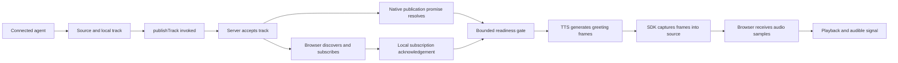

# Phase 1R — Real-time voice latency: measurement and evidence-based tuning

## Outcome and verification boundary

- Dialog now has a repeatable, stage-by-stage latency benchmark for the LiveKit voice path, bounded per-stage metrics in the worker, and a fail-closed manual-live profile for real providers.
- **All numbers in this document are mock-provider results** from a local Windows/WSL2 Docker host. They measure Dialog's orchestration, LiveKit room media and the official SDK plugins against deterministic fixtures. They say nothing about real Deepgram, Sarvam or LLM latency, network distance to providers, telephone (SIP) audio, or capacity. Do not quote them as production call latency.
- **Manual-live did not run.** No operator credential files (`.local/livekit/manual-*.env`) or recorded speech clip exist on this machine. The profile is implemented and its preflight was verified to fail before any network request.
- SIP/Vobiz/Contabo were out of scope: nothing was deployed, provisioned or called.
- Net configuration change after evidence: **turn-taking defaults are unchanged from the baseline.** Every tuning experiment that reduced latency also introduced a quality regression (split turns or stalled first turns). The shipped changes are correctness, accounting and observability changes plus one deliberate latency-for-quality trade-off (the sentence tokenizer).

## Stage definitions

Each interval is measured on a single monotonic clock: browser intervals use the page's `performance.now()`, worker intervals use the job process's `performance.now()`. The two clock domains are never subtracted from each other.

| Metric | Clock | From → to |
| --- | --- | --- |
| `browser.connectToGreetingMs` | browser | room connected → first greeting audio (includes job dispatch, worker process availability, claim, greeting synthesis) |
| `browser.e2eFirstAudioMs` | browser | synthetic user speech ends at the source → first agent audio above threshold in the subscribed track |
| `browser.playbackMs`, `browser.gaps` | browser | reply onset → last audible sample; 30–400 ms silent gaps inside a reply (each one is starvation; mock TTS is a continuous tone) |
| `browser.interruptStopMs` | browser | interrupting speech starts → last audible sample of the obsolete reply |
| `worker.sttFirstInterimMs` | worker | VAD user speaking → first STT transcript event |
| `worker.endOfTurnDelayMs` | worker (SDK metric) | end of user speech → turn committed |
| `worker.finalToLlmFirstTokenMs` | worker | last final transcript before the request → first LLM text chunk (includes the commit wait) |
| `worker.llmFirstTokenMs` | worker | LLM request start → first text chunk (worker → Dialog API hop included) |
| `worker.llmFirstToTtsAudioMs` | worker | first LLM text → first synthesized audio frame |
| `worker.ttsAuthorizeMs` | worker | TTS node start → Dialog operation admission granted |
| `worker.ttsFirstAudioMs` | worker | admission granted → first audio frame (connect, tokenization, synthesis) |
| `worker.eouToAgentSpeakingMs` | worker | turn committed → agent state speaking (playout started) |
| `worker.bargeToAgentListeningMs` | worker | VAD detects barge-in → agent listening (playout paused or interrupted) |
| `worker.ttsNoAudioGiveUpMs` | worker | (fault cases) admission → TTS stream ended without any audio |

Percentiles: p50 requires ≥ 5 samples, p90 ≥ 10, p95 ≥ 20. Below that the value is reported as unavailable, never as zero. Failures are counted per case and are not dropped from the report.

## Method

- **Path:** headless Chromium (synthetic microphone) ↔ local LiveKit server ↔ Dialog worker (`@livekit/agents` 1.9.3 with the official Deepgram, Sarvam and Silero 1.9.3 plugins) ↔ Dialog fixture API (claims, admission, usage, LLM route) ↔ deterministic mock STT/LLM/TTS.
- **Synthetic speech:** formant-synthesized voice (Silero max speech probability 0.995; an earlier sawtooth source scored 0.071 and was rejected because VAD did not treat it as speech).
- **Mock LLM** streams word-sized chunks every 20 ms. That pacing is a fixture constant, not a model estimate.
- **Cases** (per mixed session): `pause` (1.5 s speech, 450 ms pause, 1.5 s speech; one turn expected), `long` (3 s speech, long reply), `silence` (2 s of silence first; no reply may start), `interrupt` (barge-in 1.2 s into the reply), `false_interrupt` (250 ms burst 1.2 s into the reply). Repeat sessions run six `short` turns (1.2 s speech). Fault runs inject `tts_refuse`, `tts_stall` and `stt_drop`.
- **Default run:** 1 warm-up session (discarded), 10 mixed sessions, 4 repeat sessions × 6 turns, 2 runs per fault. About 25 minutes.
- **Report:** `.local/livekit/bench/<label>-<timestamp>.json` and `.md`, with environment (Node, Chromium, platform, CPUs, memory), configuration (tuning, iterations, mode), definitions, mock provider counters, aggregates and per-turn records. No credentials, identities, phone numbers, transcripts or audio are written. Manual-live reports drop per-turn records entirely.
- **Environment for all runs below:** Node v24.22.1, Chromium 156, Linux 6.6 (WSL2), Docker VM with 4 CPUs and 4 GB RAM shared by Chromium, LiveKit, Postgres, Vite, the API, the worker and its job processes.

## Results: baseline vs after (mock, same benchmark, same tuning)

Runs: `baseline-2026-10-23T05-11-16-321Z` (code before Phase 1R changes) and `after-final-2026-10-23T06-51-40-781Z` (final code and defaults). Full table: `node scripts/voice-bench-compare.mjs <before.json> <after.json>`.

### Short turns (repeat sessions; n = 24 each)

| Metric | p50 before → after | p90 before → after | p95 before → after |
| --- | --- | --- | --- |
| End of speech → first audio (browser) | 1362 → 1215 ms (−147, −10.8%) | 1794 → 1518 (−15.4%) | 1814 → 1622 (−10.6%) |
| First STT interim | 200 → 211 | 261 → 236 | 266 → 240 |
| End-of-turn delay (SDK) | 501 → 500 | 503 → 502 | 505 → 502 |
| Final transcript → first LLM token | 563 → 546 | 637 → 572 | 643 → 598 |
| LLM first token | 55 → 42 | 121 → 61 | 123 → 84 |
| First LLM text → first TTS audio | 173 → 148 | 245 → 188 | 319 → 239 |
| TTS admission | 24 → 13 | 94 → 30 | 119 → 187 |
| TTS first audio | 135 → 134 | 201 → 144 | 224 → 148 |
| Turn committed → agent speaking | 225 → 192 | 353 → 237 | 446 → 330 |

Outcomes: 24/24 ok in both runs.

**Interpretation.** No Phase 1R code change sits on the mock short-turn path in a way that explains these reductions: tuning is identical, the parallelized LLM-route reads only run in live mode, and the new tokenizer emits the same first sentence for the short reply. Treat the short-turn deltas as run-to-run variance on a shared, contended host, not as an optimization result. The dominant fixed costs are visible and unchanged: ~500 ms endpointing delay plus ~200 ms of STT chunking/interim latency before the LLM is even asked.

### Mixed cases (n ≤ 10; p90/p95 mostly unavailable)

| Case | Outcomes before | Outcomes after | Notable p50 change |
| --- | --- | --- | --- |
| pause | 7 ok, 3 duplicate reply | 8 ok, 2 timeout | duplicates gone; e2e 1310 → 919 ms (n 10 → 8) |
| long | 10 ok | 9 ok, 1 timeout | **TTS first audio 117 → 263 ms** (tokenizer, see trade-offs) |
| silence | 8 ok, 1 timeout, 1 reply during silence | same | — |
| interrupt | 10 ok | 9 ok, 1 timeout | stop 1016 → 839 ms; barge → listening 468 → 452 ms |
| false_interrupt | 9 treated as new turn, 1 timeout | 8 treated as new turn, 2 timeout | unchanged behaviour (see findings) |
| session start | 11 ok, 3 ok after retry | 13 ok, 1 ok after retry | connect → greeting p50 2174 → 1242, p90 5196 → 6976 |

The after-run timeouts are concentrated: session 5 went silent after its first turn (5 of the 7 mixed timeouts), and session 4's first turn stalled with its reply leaking into the silence case. See "Open issue: first-turn stalls".

### Fault cases (n = 2 each; no percentiles)

| Fault | Before | After |
| --- | --- | --- |
| TTS refuses connection | both runs lost the greeting (not measurable) | turn dropped in ~15 ms, next turn recovered (2/2), work settled as `unknown` |
| TTS stalls (no audio) | 1 lost greeting, 1 dropped at 10.0 s then recovered | dropped at 10.0 s (SDK `ttsReadIdleTimeout`), recovered 2/2 |
| STT socket drop | 1 recovered, 1 no recovery | 1 delivered, 1 no recovery |

Fault-run baselines are partly contaminated by slow job-process start-up, so they are evidence of behaviour, not a latency comparison.

## Experiments and decisions

All experiments ran the same benchmark on the new code with one variable changed.

| Experiment | Evidence | Decision |
| --- | --- | --- |
| `endpointingMinMs` 500 → 200 | pause case split in 4 of 5 (duplicate replies), 1 premature reply in short turns | **Rejected** |
| Preemptive LLM generation off | ~20 ms lower final-to-first-token, one LLM call per pause turn; but in a 36-turn A/B against "on" (same code, same host, back to back) 27/36 vs 35/36 short turns ok, with the first user turn stalling in 3 of 6 sessions; across all runs, first-turn stall or dead session in 4 of 10 repeat sessions with it off vs 0 of 10 with it on | **Rejected; baseline (on) kept.** Available as `DIALOG_VOICE_PREEMPTIVE_LLM=off` for further investigation |
| Preemptive TTS | not enabled: speculative synthesis is billable and the spec forbids it by default | Not run |
| Model substitution | out of scope by rule | Not run |

The initial "preemptive off" experiment (2 repeat sessions) looked clean and was briefly adopted; the larger A/B reversed it. This is why the comparison requirements insist on sample counts.

## Changes shipped in Phase 1R

1. **Benchmark harness** (`scripts/voice-smoke.mjs` with `VOICE_BENCH=1`; `pnpm voice:local:bench`), comparison script (`scripts/voice-bench-compare.mjs`; `pnpm voice:local:bench:compare <before> <after>`), refusing to compare mock with manual-live reports.
2. **Stage instrumentation** (`artifacts/livekit-agent/src/bench.ts`): fixed event names, numeric fields only, published to the room for the local harness and aggregated into `dialog_voice_stage_duration_seconds{stage,provider,mode,outcome}`. All labels are closed sets; unknown labels and out-of-range values are dropped.
3. **Dialog sentence tokenizer** (`artifacts/livekit-agent/src/sentences.ts`) for Sarvam streaming TTS: no sentence break inside URLs, decimals, dates, `Rs. 1,250`, `No. 4`, titles (`Dr.`, `Shri`, …), initials or `p.m.`; Hindi `।`/`॥` are boundaries (the plugin default tokenizer did not split Devanagari text until the end of the reply).
4. **TTS settlement:** a stream that completes with text sent but no audio is now settled as `unknown` (reconcile later), not `charged`; cancelled work stays billable/unknown and is never released as free.
5. **LLM stream decoding:** one `TextDecoder` per stream so multi-byte (Devanagari) characters split across network chunks are not corrupted.
6. **LLM route** (`artifacts/api-server/src/lib/livekit/llm-stream.ts`): scripts, knowledge and rate-card reads run concurrently before the provider request (live mode only; not measurable in mock). Billing order and per-chunk claim revalidation are unchanged; revalidation costs an estimated ~5 ms per chunk and is kept for revocation safety.
7. **Configurable, validated tuning** (`DIALOG_VOICE_STT_ENDPOINTING_MS`, `DIALOG_VOICE_ENDPOINTING_MIN_MS`, `DIALOG_VOICE_ENDPOINTING_MAX_MS`, `DIALOG_VOICE_PREEMPTIVE_LLM=on|off`, `DIALOG_VOICE_TTS_IDLE_TIMEOUT_MS`). Invalid values stop the worker at start-up without echoing the value. Defaults equal the baseline.
8. **Process readiness log** (`livekit_process_ready` with VAD load time and uptime) to diagnose slow job start.
9. **Manual-live profile** (`pnpm voice:local:bench:live`), described below.

## Trade-offs

- **Tokenizer: correctness over ~120–150 ms on some long replies.** The old tokenizer sent "Your order total is Rs." to TTS after 6 words; the Dialog tokenizer waits for "…Rs. 1,250.50 and it ships on 12.05.2026." (12 words). At the mock's 20 ms/word that is +120 ms predicted, +146 ms measured on TTS first audio for the long/interrupt/false-interrupt replies. Splitting at abbreviations causes Sarvam to synthesize a sentence-final intonation mid-amount and can break URLs; for Hindi the new tokenizer starts synthesis much earlier (word 5 vs end of reply in offline tests). Real LLM token pacing differs, so the live cost must be measured.
- **Preemptive generation stays on:** it costs extra (billable) LLM requests when a turn is split, in exchange for avoiding the first-turn stall observed with it off.
- **Endpointing stays at 500 ms min delay:** it is the largest single controllable latency, but 200 ms split natural mid-sentence pauses.
- **TTS idle timeout stays 10 s:** lower values would drop a stalled reply sooner but real Sarvam inter-chunk gaps are unmeasured; tune only with manual-live evidence.

## Provider and SDK findings

- **Sarvam plugin (1.9.3):** if the socket closes before the `final` event, the stream ends normally with no error (the reply is silently truncated); a refused connection raises an error but the plugin does not retry. It exposes no `min_buffer_size`/`max_chunk_length` options, so these were not changed. Voice, language, model (`bulbul:v3`), `linear16` at 24 kHz are preserved.
- **Deepgram plugin (1.9.3):** audio is resampled by the SDK from the 48 kHz room track to 16 kHz and sent in 100 ms chunks; the first interim therefore lands ~200 ms after speech onset even with an instant mock.
- **SDK turn handling (1.9.3, STT turn detection):** preemptive generation on a final transcript requires the turn to be committed or VAD-based detection, so it rarely fires for single-segment turns. Interruption by audio needs ≥ 500 ms of VAD speech; with false-interruption resume, the SDK pauses playout and sets the agent to listening. A 250 ms burst during a reply was treated as a new user turn in 8–9 of 10 runs (the obsolete reply is replaced, not resumed). This behaviour is unchanged by Phase 1R and should be revisited with real speech.
- **Audio conversion:** the worker contains no custom resampling or transcoding; conversions happen inside the SDK, plugins and LiveKit (Opus). Nothing Dialog-owned was found worth replacing, so nothing was changed. The Twilio media-stream path is untouched.

## Phase 1R-F — local voice reliability remediation

**Verification boundary:** everything in this section is mock-provider / local-media verification (headless Chromium ↔ local LiveKit ↔ Dialog worker on a 4-CPU / 4 GB WSL2 Docker VM, deterministic mock STT/LLM/TTS, synthetic formant voice). It is not production reliability evidence.

### Root causes (with evidence)

Phase 1R's "silent sessions and first-turn stalls" were three separate mechanisms, all triggered or amplified by CPU contention. With the host's `pnpm run dev` stopped and no added load, none of them reproduced in 30 first-turn sessions. They were reproduced deliberately with a controlled load container (`--cpus 3.5`, four busy loops) inside the Docker VM.

1. **A single failed heartbeat killed a healthy session (code defect, fixed).** The worker closed the session on the first heartbeat error. Under starvation a renewal request times out client-side (after a stall, Node's timer phase runs before pending socket reads), even though the server never refused it. Evidence: the worker logged close reason `heartbeat` while the API logged no `livekit_request_denied` for the heartbeat route in that window. When it happened during start-up the greeting never played. This matches Phase 1R's silent sessions, which followed ~10 s freezes.
2. **User speech during the greeting is discarded by the SDK (SDK behaviour, default kept).** `@livekit/agents` 1.9.3 runs an echo-cancellation warm-up (`aecWarmupDuration`, default 3000 ms; none for outbound SIP). While the agent is speaking inside that window the SDK replaces STT input with silence and ignores interruptions. Under contention the worker's playout lags what the browser hears, so a user who starts 150–600 ms after hearing the greeting end is still "talking over the greeting" from the worker's point of view. Evidence: in failing turns VAD reported `user_speaking` but the mock STT received **0 loud frames** for the whole utterance (normal turns: 13–14), and the next turn's counters were normal (speech was dropped, not delayed). With `DIALOG_VOICE_AEC_WARMUP_MS=0` the STT received the speech in every turn (0 of 58 turns lost vs 3 of 42 with the default). The default is kept because the echo risk of disabling it cannot be measured with mock media; the setting is now configurable.
3. **Agent audio track publication occasionally never completes (unconfirmed; outstanding).** In 1 of 30 uncontended sessions, 3 of 30 contended sessions and 2 of 9 post-restart sessions, the greeting was synthesized (`tts_first_audio`, `tts_end`) but neither `agent_track_published` nor `agent_track_subscribed` was emitted within 20 s. The SDK holds all agent audio until the participant subscribes. The stall is inside rtc-node `publishTrack` / LiveKit publisher negotiation. LiveKit server warnings (`udp_mux ... closed pipe`) occur only at session teardown and do not coincide. A fresh session always succeeded. The root cause is **not confirmed**.

Also observed, not fixed: after a cold worker restart, the first job's replacement idle process took 24.9 s to become ready (normal 1.1–7.7 s), and the event-loop stalls let one session's lease lapse (`heartbeat` close; correct, since the lease had expired). It happened in 1 of 4 restart runs. The single-sample premature reply in the uncontended run (150 ms gap) was a mock STT final 390 ms into a 1200 ms utterance; it did not recur.

### Changes and trade-offs

- **Heartbeat renewal** (`artifacts/livekit-agent/src/agent.ts`, `api.ts`): only a 4xx answer from Dialog ends the session. Timeouts, transport errors and 5xx retry every 250 ms until the lease could have lapsed (renewal send time + 15 s; the claim send time for the first renewal). Renewal requests time out after 4 s instead of 8 s, so a hung request leaves room to retry inside the lease. No server check changed: Dialog still rejects every request once `lease_until` has passed, `reconcile()` still closes lapsed sessions, and a test pins that a lapsed lease answers 403. Trade-off: a worker that has silently lost its lease can keep its media path up for at most the remaining lease time (< 15 s), and every paid operation in that window is still refused server-side.
- **AEC warm-up configurable** (`voice-tuning.ts`): `DIALOG_VOICE_AEC_WARMUP_MS` (0–3000; 0 disables). Unset keeps the SDK's participant-aware default. An explicit value also overrides the outbound-SIP exemption, which is why the default passes nothing.
- **Bounded diagnostics** (worker clock, names and numbers only): `loop_stall`, `heartbeat_late`, `heartbeat_retry`, `heartbeat_lost` (HTTP status or 0, ms since last renewal), `greeting_done`, `agent_track_published`, `agent_track_subscribed`, `session_end` with a closed set of reasons. The worker logs `livekit_session_closed` with its reason. The API logs the route template (never IDs) on denials and the count of expired sessions closed by reconciliation.
- **Benchmark** (`scripts/voice-smoke.mjs`): `VOICE_BENCH_FIRST_TURN=N` runs first-turn sessions that speak 150, 600 or 1500 ms after the greeting ends, then a second turn. Each records session diagnostics and mock STT counter deltas. Silent sessions are classified (`timeout_session_silent`). Mixed and repeat sessions now carry diagnostics and duration. A failed smoke turn prints the worker stage timeline and counter deltas.

Endpointing and preemptive defaults are unchanged.

### Repeated-session results

| Run | Load | Sessions (retries) | Premature closes | First turn ok | Second turn ok |
| --- | --- | --- | --- | --- | --- |
| Before fix | none | 30 (0) | 0 | 29/30 | 30/30 |
| Before fix | 3.5 CPUs | 15 (2) | 1 heartbeat | 14/15 | 15/15 |
| Heartbeat fix | 3.5 CPUs | 30 (3) | 0 | 25/30 | 29/30 |
| Heartbeat fix + STT counters | 3.5 CPUs | 21 (1) | 0 | 17/21 | 21/21 |
| Warm-up disabled (experiment) | 3.5 CPUs, heavier host load | 30 (3 + 1 failed) | 1 heartbeat (15.1 s freeze > lease) | 14/29 | 21/29 |
| **After (shipped defaults)** | none | 30 (1) | 0 | 29/30 | 30/30 |

How to read the rows:

- In the before-fix contended run, both retries were start-up failures: one heartbeat close and one unpublished track.
- In the heartbeat-fix rows, retries and failures are unpublished tracks and warm-up discards. 3 of 42 probe turns lost all speech at STT, and no session was closed early.
- The warm-up-disabled run had far heavier contention (25 of 30 sessions stalled over 1 s, maximum 9.0 s, against 3 of 21 in the probe run), so its turn outcomes are not comparable. Most of its non-ok first turns were the remainder of the greeting heard after the harness misjudged the greeting end. Its relevant result is 0 turns with speech lost at STT.
- The shipped run's single retry was an unpublished track, and its single first-turn timeout was a warm-up discard (user started 150 ms after the greeting; STT got 0 loud frames).

Same shipped run, mixed and fault cases (n = 4 and 1; regression check only):

- All 4 sessions completed; no premature closes; longest 70.8 s, under the 120 s cap.
- Pause split into two replies in 2 of 4 runs (baseline: 3 of 10).
- A false interruption was treated as a new turn in 4 of 4 runs (baseline: 9 of 10).
- Interrupt, long and silence cases were all ok.
- TTS refusal and TTS stall dropped the faulted turn and the session recovered on the next turn; STT drop still delivered the reply.

Every retry above is a harness retry with a new session. Each retried session was closed first, and no duplicate first-turn reply was observed in any run.

### Worker readiness and recovery

- **Worker restart:** healthy 7–14 s after `docker restart`. Over 3 rounds, the smoke checks passed 3/3, 18/18 turns were ok, and 2 of 9 sessions needed a fresh-session retry (unpublished track). A session in flight during a restart is ended through the shutdown callback, which still records ambiguous usage as `unknown` and closes the claim.
- **LiveKit unavailable 30 s:** the SDK reconnected in place. The readiness endpoint (`:8081`, proxied by `/readyz`) returned 503 during the outage and 200 about 6 s after LiveKit returned. Smoke passed and 3/3 sessions and 6/6 turns were ok.
- **LiveKit unavailable 100 s:** beyond the SDK's ~80 s reconnect budget the worker process exited and Docker restarted it once (`restart: unless-stopped`). It was healthy 6 s after LiveKit returned; smoke passed and 3/3 sessions were ok.
- The Docker health check needs 20 failures 5 s apart (about 100 s) to mark the worker unhealthy, so short outages show only in readiness, not in `docker ps`. Docker does not restart unhealthy containers; recovery relies on the SDK's reconnect and the process exit.
- Expired, replayed and concurrent claims, stale leases, revoked tenant sessions and suspended tenants fail closed in the PostgreSQL suite. Lease renewal and the 403 on a lapsed lease are now asserted explicitly.

### Outstanding issues

- Unpublished agent track (cause unconfirmed; 1 in 30 uncontended sessions). Callers would hear silence until the session ends. Investigating it needs LiveKit server debug logs or an rtc-node upgrade, not a Dialog-side timeout.
- Warm-up discard: callers who talk over the first 3 s of the greeting lose those words, and if they then wait, nothing happens. Revisit `DIALOG_VOICE_AEC_WARMUP_MS` with real devices and echo measurements.
- Cold-start prewarm contention (`numIdleProcesses: 1` spawns a replacement process at every job start) can starve the first session after a restart.
- A host freeze longer than the 15 s lease still ends the session. That is the intended fail-closed behaviour.
- False interruptions are still treated as new turns, and 450 ms pauses still sometimes split, both unchanged from baseline.

## Cost implications

- Mock runs incur no provider cost.
- Preemptive generation (kept on) issues an additional LLM request when a turn is split; the cancelled request is billable and is accounted as such (baseline pause case: 13 LLM starts for 10 turns, 1 cancelled).
- TTS work that produced no audio is now `unknown` rather than `charged`, so it goes through reconciliation instead of being billed or released blindly.
- A manual-live run is bounded to at most `1 + 2×warm-up + 6×(mixed + repeat)` user turns (default 19), each costing one Deepgram stream segment, one LLM completion and one Sarvam synthesis at the operator's rates.

## Commands

```powershell
pnpm voice:local:up                  # local stack (mock providers)
pnpm voice:local:smoke               # functional smoke (no benchmark)
$env:VOICE_BENCH_LABEL='after'; $env:VOICE_BENCH_FAILURE_RUNS='2'
pnpm voice:local:bench               # mock benchmark (~25 min)
pnpm voice:local:bench:compare .local/livekit/bench/<before>.json .local/livekit/bench/<after>.json
pnpm voice:local:down
```

Benchmark size: `VOICE_BENCH_WARMUP` (0–5), `VOICE_BENCH_ITERATIONS` (mixed sessions, 0–50), `VOICE_BENCH_REPEAT_SESSIONS` (0–20), `VOICE_BENCH_FAILURE_RUNS` (0–5), `VOICE_BENCH_FIRST_TURN` (first-turn reliability sessions, 0–100). `DIALOG_VOICE_AEC_WARMUP_MS` (0–3000) overrides the SDK echo-cancellation warm-up. Tuning experiments: set a `DIALOG_VOICE_*` variable and rerun `pnpm voice:local:up` (the worker is recreated with it).

**Manual-live (real, paid providers; operator only):**

1. Put `DEEPGRAM_API_KEY` and `SARVAM_API_KEY` in `.local/livekit/manual-worker.env`, and an LLM key (`OPENAI_API_KEY`, `DEEPSEEK_API_KEY` or `SARVAM_API_KEY`) in `.local/livekit/manual-api.env`.
2. Record a short spoken utterance as `.local/livekit/bench/live-utterance.wav` (1 KB–5 MB).
3. `$env:DIALOG_VOICE_LIVE_BENCH='paid-providers'; pnpm voice:local:bench:live`

The preflight checks, in order, the explicit setting, key presence (names only; values are never read into output), the clip and the run limits (warm-up ≤ 1, mixed ≤ 3, repeat ≤ 2, no fault injection) before starting anything. The worker and API are switched back to mock mode afterwards even on failure. Manual-live never runs during install, build, tests, smoke or the mock benchmark, and its reports contain aggregates only.

## Provisional thresholds (not yet validated)

These are targets for the first real measurements, not achieved results: end of speech → first audio p50 ≤ 1.2 s and p95 ≤ 2.0 s on a manual-live run; zero duplicate replies for a single 450 ms pause; zero first-turn stalls in 20 sessions; barge-in → playout stopped p90 ≤ 600 ms.

## Not verified in Phase 1R

- Real provider latency (Deepgram, Sarvam, LLM) and variance from India-region network paths.
- Telephone audio (8 kHz, SIP/Vobiz) and its jitter buffers.
- Behaviour with real human speech, noise and accents (synthetic formant voice only).
- Concurrency and capacity; this was a single-session benchmark.
- Whether the parallel LLM-route reads reduce live time-to-first-token.

## Contabo staging experiments (future phase; nothing applied)

1. Run the mock benchmark on the staging host (dedicated CPU, no browser on the same machine) to separate code behaviour from host contention, and check whether first-turn stalls persist.
2. Run manual-live with operator credentials from the staging region; compare against the provisional thresholds.
3. Repeat the endpointing (300/400 ms) and preemptive-off experiments with real speech and ≥ 20 sessions each.
4. Measure SIP call audio end-to-end only after Vobiz execution is explicitly enabled in a later phase.

## Phase 1R-G — publication diagnosis and bounded readiness (2026-10-24)

**Status: unresolved finding; runtime verification pending. Do not interpret the safeguards below as a confirmed publication root-cause fix.**

### Version-specific audit

The manifests, frozen lockfile and installed source agree on agents and Deepgram/Sarvam/Silero plugins **1.9.3**, rtc-node **1.1.0**, server SDK **2.19.2**, and browser client **2.23.0**. Compose pins LiveKit server **v1.13.10** by digest. The agents peer requirement is rtc-node `^1.1.0`; the installed version satisfies it. No dependency versions changed.

Source paths below are relative to the installed package, not claims about another SDK release:

1. Agents `voice/agent_session.ts` starts RoomIO without awaiting its background initialization. Returning from `session.start()` therefore does **not** establish media readiness.
2. Agents `voice/room_io/room_io.ts` waits for room/participant readiness, creates `AudioSource`/`ParticipantAudioOutput`, and starts publication. `_output.ts:ParticipantAudioOutput.publishTrack` creates `roomio_audio`, awaits `localParticipant.publishTrack()`, then awaits the returned publication's `waitForSubscription()`. Its capture path waits for that readiness future before forwarding audio. TTS completion is independent evidence and cannot establish delivery.
3. rtc-node `participant.ts:LocalParticipant.publishTrack` acquires the participant FFI lock, sends a native publish request and waits for its matching asynchronous callback using the room disconnect signal. On success it creates and stores a `LocalTrackPublication`; on error it rejects. Source inspection cannot establish which internal/native/server step stalled in the historical sessions.
4. rtc-node `room.ts` handles `localTrackPublished` separately, looking the publication up in the map. The event and publication promise are distinct observations. `track_publication.ts:waitForSubscription()` waits for the first subscription future. The old two room-event markers cannot distinguish an unresolved publish, an event/payload race, or missing subscription. The Phase 1R-F assertion that the stall was inside publisher negotiation was stronger than its evidence supports and is superseded here.
5. Browser track discovery, subscription, receiver samples, HTML playback state, and measured nonzero audio are separate boundaries. A `playing` event alone is not evidence of audible samples. The mock harness's analyser remains the audible-playback measurement; receiver `totalSamplesDuration` is a first-sample proxy, not a packet capture or human listening test.

The two server-acceptance branches can be observed in either order; missing one room event does not identify a failing publication promise. Previously TTS ran in parallel with publication. The new greeting waits at the readiness gate:



### Safeguards and diagnostics

- `media-readiness.ts` observes the connected participant's public `publishTrack` method for the single SDK-owned output. It preserves its arguments, result and rejection, creates no track, and performs no retry. It records track existence at the call boundary (not an exact AudioSource-constructor timestamp), invocation, promise resolution/rejection, and subscription readiness. It restores the method at teardown. This instrumentation must be reviewed if output ownership or SDK versions change.
- A **12-second overall readiness budget**, starting after room connection, fails closed with `media_timeout`. `publication_timeout` and `subscription_timeout` distinguish the pending phase. This is a new failure bound, not an increased existing timeout. Greeting synthesis is gated on readiness; input audio is disabled until readiness. STT still receives server authorization before session startup, and any admitted STT work is conservatively reconciled as unknown on closure. The installed SDK can initialize its STT stream during session startup; this change does not claim that all provider activity is gated on media readiness.
- The close path aborts the application, clears heartbeat/loop timers, captures a failure-only server participant/publication-count snapshot (one-second server SDK deadline), disconnects the room to cancel native publication waits, bounds local disconnect/session close waits to two seconds each, reconciles admitted STT work, closes the authorized API session and calls `ctx.shutdown`. API calls retain their existing individual deadlines. Late publication completion cannot turn failed readiness into success. There is no automatic session or publication retry.
- A random `dialog.diagnostic` participant attribute joins worker acceptance, job entry/claim, publication logs, server inspection and browser diagnostics. It is not an authorization credential or metric label. Logs exclude room/participant/track identifiers, caller data, provider payloads, transcripts, audio and credentials. Worker timing offsets use monotonic clocks; browser offsets are kept separate and never subtracted from worker offsets.
- `bench.ts` caps outstanding room diagnostic sends at 64, queued metric observations at 200, and permits one forwarding request at a time. Browser diagnostic histories are bounded. Diagnostics may be dropped under overload; an absent marker is not proof that the operation did not happen.
- `LivekitPreview.tsx` adds development-only discovery, subscription, first receiver-sample and playback-state events. Receiver polling stops after 12 seconds or disconnection. `voice-smoke.mjs` records these events and publication-to-subscription duration. Benchmark session helpers now make one attempt, with no hidden connection or greeting retry. An incremental JSONL ledger preserves completed first-turn attempts even if later report generation fails. First-session populations bypass the smoke preflight so their first job is actually measured after restart.

### Cold-start audit and admission

Agents `ipc/proc_pool.ts` uses a warmed-process queue with a one-idle-process target. Consuming a process releases its pool slot and starts replenishment; initialization is serialized by an initialization mutex. The installed source releases that mutex after enqueue. `worker.ts` health checks WebSocket/inference connectivity, not idle-process availability. A healthy HTTP response therefore did not imply that dispatch could immediately obtain a warmed process. VAD already loads in prewarm with CPU inference; the installed Silero ONNX options use one intra-op thread. There is no evidence yet assigning the historical 24.9-second delay specifically to ONNX, scheduling, imports, reconnect or dispatch.

`process-readiness.ts` and the worker's authenticated loopback registration reserve a single-use process only after VAD prewarm completes. Startup with no ready process, replenishment and a dead registered PID refuse new jobs before claim/provider authorization; `/readyz` also requires an available process and SDK connectivity. Compose health now uses `/readyz`. Registration occurs immediately before the prewarm callback returns; the SDK's final initialization/queue handoff is still asynchronous, so a small handoff interval remains and needs runtime measurement. A reservation is consumed even if assignment later fails; it is never reused for an ambiguous dispatch. The 60-second SDK process initialization timeout and the **15-second claim lease are unchanged**.

Availability trade-off: if assignment fails without consuming the SDK's idle process, its reservation remains consumed. Admission then stays unavailable until a confirmed new prewarm registration or manual recovery; the application does not guess that reusing that process is safe. This is a remaining recovery limitation, not a publication retry.

Setup observation from this host: Docker dependency installation took about 29 minutes, and its standalone ONNX import validation step took 197.2 seconds while image setup was in progress. The host reported about 610 MiB free out of 8 GiB, with a four-CPU / 3.65-GiB Docker VM. These are setup observations under resource pressure, not cold-job measurements and not proof of the historical 24.9-second mechanism. Setup load must finish before a normal-load session population can be interpreted.

### Verification record

Historical Phase 1R-F publication-marker failures remain **1/30 uncontended, 3/30 controlled CPU contention, 2/9 post-restart**. These are distinct populations and remain failures. They were not direct publication-promise measurements.

The strict PostgreSQL catalogue passed on Node 24.22.1: **301/301 tests across all 18 suites, zero failed, skipped or cancelled**. Suites ran serially to avoid this host's memory pressure; their internal deadlines and connection-race coverage were unchanged. The retained summary is `.local/livekit/bench/1rg-strict-node24-serial-1792849791363.jsonl`. Earlier parallel runs encountered deadline cancellations under setup load and are not passes. Worker lifecycle/provider tests also passed **17/17**, with no skips or cancellations. Affected worker/frontend typechecks passed; workspace production builds, secret scan and schema-push guard passed during implementation.

New session populations and final checks are recorded below as execution finishes. No statistical improvement or confirmed intermittent root cause is claimed from unit tests. Closure still requires the requested 100 normal attempts, 50 separately stressed attempts, 10 cold restart rounds and fault regressions, retaining every failure and timeout.

The ongoing normal population has already reproduced distinct failure paths. One direct publication rejection occurred about 10.185 seconds after the connected media gate began, alongside a 6.7-second event-loop stall. The failure-only server snapshot found both participants but zero agent publications; the worker closed with `publication_rejected` and completed cleanup in 3.155 seconds. This establishes a rejected public call and bounded cleanup, not the underlying native/server cause. Another silent greeting completed publication, subscription and `greeting_done`, with near-zero browser amplitude: successful publication is therefore insufficient to explain or rule out all greeting failures. Both remain failures; no retry replaced them. Initial sanitized worker evidence is retained in `.local/livekit/bench/1rg-normal-initial-evidence.json`; the incremental attempt ledger retains browser and worker stage evidence.

After 13 accepted/claimed jobs, no child job processes remained, although 14 prewarm registrations had completed. Admission returned 503 and refused subsequent jobs before claim. Container restart count and cgroup OOM counters were zero. The installed `proc_pool.ts` transfers its semaphore release into the warm queue after successful initialization and does not release it on process exit once transferred; normal consumption releases it in `launchJob`. This is a **confirmed recovery bug**: the focused `pool-recovery.test.mjs` executes the actual installed pool with controlled OS-process substitutes and fails on the original package because an exited idle process keeps its queue entry and its capacity slot.

`patches/@livekit__agents@1.9.3.patch` fixes this bug without a version upgrade. It removes the exited process from the idle queue and uses one idempotent slot-release function for dispatch, exit and shutdown. It covers the package's source, ESM and CommonJS implementations; pnpm's patched dependency and lockfile retain the fix, and the Dockerfile copies patches before frozen installation. No application access to private SDK queues is introduced. The regression passes after installation, including normal dispatch followed by exit without a duplicate release. All **18 worker tests pass**, with no skips or cancellations; the one sandbox-only HTTP test failure (`EACCES` on loopback) passed when rerun with the required loopback permission.

A direct local check loaded the exact patch into the existing mock image and restarted the worker once to load the corrected code. Killing the verified idle PID 81 caused automatic replacement by PID 231 with a successful prewarm registration and readiness recovery, **without restarting the worker after the injected exit**. The readiness poll returned 200 about 1.5 seconds after it began; this excludes Docker command overhead. This validates pool replacement, not the cause of the original process exit or all intermittent media failures. The SDK child orphan timer is 15 seconds without a parent ping, whereas the parent watchdog is 60 seconds; parent starvation is a hypothesis requiring further evidence, not an established exit cause. Lease expiry remains 15 seconds.

The large population was stopped in response to the user's direction to focus on the fix. Its ledger contains 100 records, but 39 are immediate `harness_error` records generated after browser shutdown; they are **not 39 genuine session attempts**. There are 10 greeting successes and 51 `no_greeting` records, with 8 successful first turns and 9 successful second turns. The report must not advertise this as 100 completed normal trials or an after-fix reliability result. The harness now stops iterating when the browser closes and reports remaining planned attempts as unaccounted through the driver. The required complete 100/50/10 populations and fault regressions remain outstanding; no success claim is made for them. The focused post-fix mock-call result is recorded separately below when complete.

Focused post-fix report: `.local/livekit/bench/1rg-pool-fix-2026-10-24T14-28-15-342Z.json`. **Three genuine sessions, three successful publications/subscriptions/greetings, no retries, three successful second turns; only one successful first turn and two `timeout_no_response` failures.** The call population is therefore not a full pass, despite the harness command exiting zero. In one failing first turn, STT received 14 loud frames, emitted finals, and LLM/TTS completed with first audio; the browser detected no response. This is distinct from admission failure and from the zero-loud-frame AEC discard documented in Phase 1R-F. No speculative AEC, timeout or lease change was made to hide it. Pool recovery is fixed and directly verified; the intermittent publication/audio-path cause remains unresolved, so Phase 1R-G remains open.

The mock-only orchestration entrypoint is `node scripts/voice-reliability.mjs normal|stressed|cold|regression|outage|lease-expiry`. It validates isolated mock configuration, retains phase JSONL ledgers and sanitized worker evidence, runs normal/stressed populations separately, and creates a network-isolated, CPU-capped (3.5 CPUs, four loops) load container only for the stressed group. Cold rounds record readiness time and startup failures independently of attempted sessions. A successful report write is not a successful population: missing reports, unaccounted attempts and failed first/second turns make the orchestration exit nonzero. The regression group covers the existing mixed, repeated-turn, TTS refusal/stall and STT drop cases. The separate outage/lease-expiry groups wait for a newly subscribed agent, then stop LiveKit briefly or pause the worker for 18 seconds. They restore service state in `finally`, retain the injected fault and session outcome, and require a completed cleanup marker. Preparing these checks does not establish that they passed; execution results must be recorded separately.

CI now builds the worker and runs its lifecycle/provider-adapter tests. The latency report has a specific `.gitignore` exception so it can be retained with the change.

Real Deepgram, real LLM, real Sarvam, human speech, phone audio, Vobiz/SIP and production deployment remain **unverified**. No paid-provider run, external SIP provisioning, Vobiz enablement or Contabo deployment is part of this change.

## Phase 1R-G continuation — audio boundary investigation (25 October 2026)

**Status: still open.** All required normal/stressed/cold attempts were accounted for, but every population contained genuine failures. The sequence stopped after an outage harness failure; lease-expiry was not run. The previous post-TTS silent turn is not retrospectively explained by a later successful run.

### Reproduced first-turn measurement error

The three before-correction cold probes reproduced one `timeout_no_response`, one `premature_response` and one successful first turn. All three greetings and all three second turns were audible. Reports: `.local/livekit/bench/1rg-audio-cold-probe-{1,2,3}-*.json`, with separate incremental `attempts-*.jsonl` files.

In cold probe 1 (`1rg-audio-cold-probe-1-2026-10-25T01-44-44-617Z.json`), the worker generated 22 greeting frames / 2,145 ms of audio, at normalized peak 0.2136, and the linked source accepted all 22. VAD detected the first user speech at worker offset 2,295.9 ms, while the greeting source continued until drain completion at 3,925.5 ms and `greeting_done` at 3,930.0 ms. During the nominal first-turn window the browser analyser still measured greeting amplitude around 0.214, receiver energy increased, and playback was active/unmuted. STT received 141 frames but **zero loud frames and zero transcripts**. This is consistent with the installed SDK's documented AEC warm-up suppression while the greeting is still speaking, rather than a generated response disappearing downstream. The second cold probe similarly counted the remaining greeting as a premature response without generating a first-turn reply.

The harness's 120 ms quiet predicate could accept a gap inside a streaming greeting as its end. `voice-audio-boundary.mjs` now requires both a non-interrupted `greeting_done` for the currently subscribed session token and the existing analyser silence predicate. It returns the actual last audible browser timestamp; it does not substitute the worker timestamp or subtract clock domains. The 0.02 amplitude threshold, 120 ms quiet duration and existing 20-second deadline are unchanged. Missing completion or missing sound fails the greeting instead of falling through as a success. AEC, VAD, endpointing, preemptive generation and the 15-second lease are unchanged. Interruption regression scenarios still deliberately speak during replies.

After correction, all three focused cold sessions passed greeting, first and second turns, with no retries and no user speech preceding `greeting_done`. Reports: `.local/livekit/bench/1rg-audio-cold-after-1-2026-10-25T01-47-37-743Z.json`, `...after-2-2026-10-25T01-48-08-517Z.json` and `...after-3-2026-10-25T01-48-38-177Z.json`. Requested first-turn gaps were 150 ms; measured browser gaps were 209.4, 208.8 and 236.6 ms, including harness bookkeeping. These three probes do not replace the required ten-round cold population.

### Coverage of the remaining silent path

`audio-diagnostics.ts` observes public output/source methods only in local benchmark sessions. It records bounded numeric frame counts, audio duration, peak amplitude, source/track association, capture acknowledgements, flush/clear/pause/resume and playback boundaries. It creates no track, replaces no source and changes neither audio samples nor forwarding decisions. TTS summaries, authorized LLM response boundaries, conversation commits and speech completion add the missing generation-side evidence. The observers restore methods at teardown; their new test verifies original frame identity, single forwarding, original errors, cleanup and the 2,000-event cap. No audio, transcripts or native handles are retained.

The preview reports bounded continuous receiver sample-duration/energy counters, source liveness and element playback state. The harness records per-turn analyser peaks, context-running state, source/receiver events and full stage timelines, using one random session diagnostic token. Receiver samples can include silence or concealment; neither sample duration nor `greeting_done` alone counts as audible delivery. The source acknowledgement proves native acceptance, not independent packet transmission. Actual received energy and analyser amplitude remain separate observations.

Six restored normal diagnostic sessions and three separately controlled CPU-load diagnostic sessions passed all greetings and first/second turns before the harness correction. The earlier three-session probe contained one premature greeting-tail response. The original post-TTS silent response was **not reproduced in those normal/stressed probes** and remains unresolved pending the full populations. No speculative provider, SDK-version or production audio-setting change was made.

One six-session diagnostic setup was interrupted before any genuine session when all required fixture containers exited together with code 143; its interruption artifact is retained. One stressed setup had zero genuine sessions because of a counter-scope implementation error; it is separately recorded and corrected, and its load container was cleaned up. Neither setup failure is counted as a session or silently replaced in the reports.

### Reporting and build verification

The session harness now records a genuine session only after a 201 API creation response. It stops on browser/harness failure rather than manufacturing the remaining attempts. `voice-reliability-results.mjs` requires every first-session attempt's greeting, first turn and second turn individually, rejects duplicate/missing iterations and retries, counts non-session/harness errors separately, and checks the regression case catalogue and actual fault injection. Missing reports, incomplete populations and failed cases cause nonzero orchestration results even if the benchmark command itself exits zero.

The initial continuation Docker build completed using pnpm 10.13.1 and Node 24.22.1. An isolated, network-disabled check of that image confirmed agents 1.9.3 with the retained slot-release/queue-removal patch in **both ESM and CommonJS runtime files**. All **26/26 worker tests passed inside that image**, zero failed/skipped/cancelled. Affected worker/frontend typechecks passed. Final checks and populations are recorded below.

### Completed continuation populations

The retained sequence is `.local/livekit/bench/1rg-verification-sequence-1792893243561.jsonl`. Its recomputed aggregate, report filenames, phase ledgers, restart/readiness timings and incremental attempt-ledger paths are in `.local/livekit/bench/1rg-continuation-verification-summary-1792898100795.json`. Reports are unique and earlier failures remain intact. There were no session retries, harness errors or unaccounted attempts within these three completed populations:

| Population | Genuine attempts | Greeting success | First-turn success | Second-turn success | Distinct failed sessions |
| --- | ---: | ---: | ---: | ---: | ---: |
| Normal | 100 | 99 | 99/99 exercised | 99/99 exercised | 1 |
| Controlled CPU stress | 50 | 41 | 39/41 exercised | 40/41 exercised | 12 |
| Cold restart | 10 | 9 | 8/9 exercised | 9/9 exercised | 2 |

Normal: one `no_greeting`, no turn timeouts. Report `1rg-normal-1-2026-10-25T02-28-20-855Z.json`; ledger `attempts-1rg-normal-1-1792893268873.jsonl`. The failed job was accepted, entered its warmed process and completed API claim in 82 ms, but has no confirmed connection/publication or worker cleanup marker. The last confirmed boundary is claim, not publication. Evidence: `1rg-continuation-normal-early-worker-evidence.json`.

Stress: eight `no_greeting`, one `greeting_incomplete`, two first-turn `timeout_no_response` and one second-turn `timeout_no_response`. Report `1rg-stressed-1-2026-10-25T02-51-12-629Z.json`; ledger `attempts-1rg-stressed-1-1792895332670.jsonl`. The network-isolated four-loop load was capped at 3.5 CPUs and its removal was recorded in `phase-1rg-stressed-1792895304924.jsonl`. Five failures have direct publication rejections; others include lease loss and event-loop stalls up to 14,356 ms. The initial startup failure again stops after claim. These are separate failure mechanisms.

Cold: all ten restarts, readiness recoveries and genuine first-job attempts completed. Restart durations were 917–2,712 ms; post-restart readiness checks took 3,682–14,211 ms. Rounds 1–8 passed greeting and both turns. Round 9 had a first-turn `timeout_no_response`; round 10 had `no_greeting`. Reports `1rg-cold-{1..10}-2026-10-25T*.json` and their attempt ledgers are enumerated in the aggregate. The phase ledger is `phase-1rg-cold-1792896681594.jsonl`. This does not resolve the historical cold-start mechanism or establish the final SDK queue-handoff race as its cause.

### Confirmed remaining audio boundary

Stress iterations 15 and 21 reproduced the post-TTS silent-response class. In iteration 15, STT received 14 loud frames and produced a worker final; LLM authorization/output completed; TTS generated **31 frames / 3,025 ms, peak 0.213623**, without cancellation or synthesis failure. Output was paused three times after the user-listening marker. Its first reply-frame capture remained pending (23 total output calls, only 22 completed greeting frames). The linked source remained at its 22 greeting frames / 2,145 ms, issued `source_clear`, and received **no reply-frame capture**. Browser playback remained active, unmuted and live; receiver energy stayed constant and analyser peak was zero throughout the failed response window. Iteration 21 shows the same paused-output/source-clear boundary with 13 loud STT frames and another complete 31-frame TTS stream. The first missing forwarding boundary is therefore **output capture → LiveKit source capture**, before transport or browser measurement. This is stronger evidence than TTS completion alone; it does not prove why the SDK kept output paused.

The second-turn failure at stress iteration 11 is different: the mock counted an STT final, but the worker recorded only interim transcripts, no committed reply, and no LLM/TTS. Publication rejections are also distinct. Do not describe all timeouts as one transport failure.

Full numeric timelines remain in the stress report and `1rg-stressed-failure-boundaries-1792896373507.json`; sanitized worker snapshots include `1rg-worker-evidence-1792895583783.json`, `...1792895758468.json`, and `...1792896534972.json`. An installed-SDK method probe can construct a paused, user-silent state with no resume timer, but its synthetic callback sequence alone does not establish the actual VAD ordering. A pause/VAD scheduling race is a hypothesis, not a confirmed root cause. No speculative forced resume, AEC/VAD/endpointing change, SDK upgrade or retry was introduced.

### Regression, outage and fixture correction

Regression report `1rg-regression-1-2026-10-25T03-06-16-592Z.json` contains all 22 required records: **16 accepted, 6 failed**, zero missing catalogue records. All three session greetings, six repeated short turns, two long turns, two silence cases and two interruption cases passed. Of two 450 ms pause cases, one passed and one produced `duplicate_response`. Both false-interruption cases produced `false_interruption_dropped_reply`. TTS refusal/stall scenarios failed at greeting before confirmed fault injection, so those faults were not verified. STT drop recorded one injected failure but outcome `reply_delivered`; the required fail-closed/recovery assertion did not pass. These results do not establish that duplicate replies or unexpected closures were eliminated.

Outage report `1rg-outage-1-2026-10-25T03-08-28-021Z.json` records **one genuine session and one harness error**. The LiveKit stop and restart succeeded and worker cleanup completed with reason `heartbeat`, but the fixture ingress gateway crashed with `ERR_SOCKET_DGRAM_NOT_RUNNING` while closing an unbound UDP peer. This also removed browser/frontend and host PostgreSQL access. The parent sequence stopped, retained the report, and did not run lease-expiry. It did not replace the failed outage attempt.

`udp-peer.mjs` now removes a peer before closing it, closes once, tolerates an already-unbound socket, and prevents a late old-socket error from deleting a replacement. `gateway.mjs` uses that path for error and idle cleanup, and Compose mounts the helper. Two tests cover actual unbound/bound UDP sockets and duplicate eviction. Only the gateway was restored after the stopped sequence; the outage population has **not** been rerun. The standalone lifecycle command's incorrect zero exit on a harness failure was also fixed and regression-tested; injected fault, restoration, one genuine attempt, cleanup and error-free harness are now all required.

The database audit over this sequence found **167 mock sessions, all closed**, and **167 completed room deletions**. Provider operation states were STT unknown 163/admitted 3, TTS completed 471/unknown 1/admitted 3. Six admitted provider operations remain unsettled, so conservative usage reconciliation is not a full pass. The final aggregate audit is retained in `1rg-continuation-cleanup-audit-1792898224620.json`. Mock mode bypasses the financial ledger; these state counts do not prove real-provider charges or billing correctness.

### Final repository checks and changed files

Workspace typechecks and all production builds passed, including worker/API/frontend. Frontend Vite reported sourcemap and bundle-size warnings without build failure. Secret scanning, schema-push guard and whitespace checks passed. No Twilio implementation file changed. The final frozen-install image is config `sha256:3623f5e9f26346b65734d7be97702fc67fbdcaea08f67340c6db2d9b8cec8deb`; its ESM/CommonJS pool patch checks passed and **29/29 worker/gateway tests passed inside the image**, zero failed/skipped/cancelled, without source mounts or network access.

The first final PostgreSQL run occurred while the gateway was down: **280 passed, 18 failed, 3 skipped, 0 cancelled** of 301; this is a failed strict run, retained in `1rg-strict-node24-serial-1792897735380.jsonl`. The fresh strict run after gateway restoration passed **301/301 across 18 suites, zero failed/skipped/cancelled**, retained separately in `1rg-strict-node24-serial-1792898026053.jsonl`. It includes relevant API, widget/security, Twilio webhook and deployment checks. The frontend package has no separate test command; its typecheck/build and browser reliability scenarios supplied its verification here.

Changed files in this continuation: `artifacts/livekit-agent/src/{agent.ts,bench.ts,server.ts,audio-diagnostics.ts}`; `artifacts/livekit-agent/test/{voice.test.mjs,audio-boundary.test.mjs,gateway.test.mjs,reliability-results.test.mjs}`; `artifacts/sales-sutra/src/pages/LivekitPreview.tsx`; `deploy/livekit/{compose.yaml,gateway.mjs,udp-peer.mjs}`; `scripts/{voice-smoke.mjs,voice-reliability.mjs,voice-audio-boundary.mjs,voice-reliability-results.mjs}`; and this report. Evidence remains under ignored `.local/livekit/bench`; the continuation change set is listed here.

**Next justified action:** capture numeric VAD speech/silence and pause/resume ownership/timer ordering in a focused reproduction of the demonstrated output-to-source stall, then test a targeted correction. Publication rejection, post-claim startup loss, unsettled operations and the failed/missing fault scenarios also remain open. Real providers, human speech, SIP/Vobiz and production reliability remain unverified.

## Focused paused-output correction — 25 October 2026

**Partially fixed; Phase 1R-G remains open.** The missing pause transition is corrected and demonstrated through the native source and browser, but startup failures and incomplete audio still prevent a reliability pass. Agents remains 1.9.3, rtc-node 1.1.0, and the existing process-pool recovery change is retained. No provider, AEC/VAD threshold, endpointing, preemptive-generation, lease, timeout or analyser setting changed.

### Actual failure and state ownership

The new before-correction sample was three normal sessions and six separate sessions under the same 3.5-CPU/four-loop contention. Normal passed all greetings and both turns. Stress had five greetings, four successful first turns and four successful second turns: one startup failure, one lease-loss timeout before TTS, and one confirmed paused-output timeout. All attempts were genuine; no retry, harness error or unaccounted attempt. Reports: `.local/livekit/bench/1rg-pause-trace-normal-2026-10-25T03-32-41-174Z.json` and `1rg-pause-trace-stressed-2026-10-25T03-36-27-436Z.json`, with separate incremental attempt ledgers and focused-run ledgers. The controlled load was removed in `finally`.

Stress iteration 6 first turn reproduces the historical boundary with 14 loud STT frames, a final, complete authorized LLM/TTS, 31 TTS frames / 3,025 ms / peak 0.213623, and a first reply capture held ahead of the source. This time the actual activity state is available: current and paused speech are the same live handle; VAD becomes silent; the native output remains paused; no resume timer or pending turn-settlement callback owns that pause. The second timeout, iteration 5 second turn, is lease loss before TTS and is not this defect.

`AgentActivity` owns `pausedSpeech`, `userSilenceEvent`, `falseInterruptionTimer` and `falseInterruptionPending`. `ParticipantAudioOutput` owns `playbackEnabledFuture`; its capture clears queued native audio then waits on playback enablement or interruption. `source_clear` in this trace is the consequence of entering that wait, not evidence of cancelled synthesis.

| Actual worker offset / callback | State before → after | Timer owner / expected action | Invariant |
| --- | --- | --- | --- |
| 10,863.8 ms: speech start | Silent → speaking; no active reply | None | Speech can gate future output. |
| 12,527–12,528 ms: STT end hook | Speaking → silent; no paused speech yet | No timer needed yet | Listening alone does not guarantee a later reply remains unpaused. |
| Queued VAD continues after STT end | Silent → speaking again from older audio | STT end queues `vadStream.flush()` | Ordered VAD backlog may arrive after the STT callback. |
| 13,208.7 ms onward: delayed VAD interruption | New reply becomes current and paused; no timer | `interruptByAudioActivityOnce` pauses it and cancels any old timer | A subsequent legitimate end/silence must own a resume path. |
| 14,852.9 ms: VAD accumulated silence | User-silence flag becomes true; same paused reply | Still no timer | This event still reports `speaking=true`; the correction waits for actual non-speaking inference. |
| 14,868.7–14,870.6 ms: reconcile / capture | Valid existing pause retained; first reply capture pending | `reconcilePlayoutPause` returns without scheduling | A complete TTS stream does not release a pause. |
| 14,997.5 ms sampled post-flush inference | `speaking=false`, speech duration reset to zero; paused live reply remains | Original SDK: no timer and no end callback | **Violated:** a silent live held reply has no remaining resume trigger. |
| Further silent inferences until next speech | Same handle, silent, paused, timer absent | Original SDK never arms one | No reply frames reach the native source. |

The exact installed code explains the missing callback: `AudioRecognition.onSTTEvent(END_OF_SPEECH)` calls the activity's end hook and then flushes an outstanding VAD segment. Silero processes that sentinel after already queued audio and resets `pubSpeaking`/durations **without emitting `END_OF_SPEECH`**. The recorded false inference has speech duration zero, silence duration 32 ms and raw accumulated silence zero, matching that reset rather than a natural VAD end. Delayed queued VAD audio can therefore pause a reply after STT ended, and the flush removes the VAD end event that would normally arm its resume timer. `AgentActivity.onVADInferenceDone` only updated the silence flag; it did not restore timer ownership. This is a missing transition, not a lost or late firing timer.

### Targeted correction and deterministic evidence

The retained pnpm patch adds one transition in source, ESM and CommonJS `AgentActivity.onVADInferenceDone`: a non-speaking inference arms the existing false-interruption timer for the existing paused speech, only when it is current, uninterrupted, unfinished, owned by the active activity, pausing is enabled, and no timer or pending turn decision already exists. It uses the unchanged `pausedSpeech.timeout`. It does not call `resume()` directly, reset an existing deadline, resume a stale handle, alter generation or retry audio. Existing speech-start/turn-commit/cancellation/close paths continue to own cancellation and native frame rejection.

`installed-pause-contract.test.mjs` executes the installed activity and participant-output implementations, replacing only the native source with a deterministic sink. It reproduces STT end → delayed VAD pause → silent post-flush inference both before and after the first capture starts. Both cases fail on the original package with `silent inference after flush must own a resume timer` (**5 passed / 2 failed**, zero skips/cancellations). With the correction both release all 31 valid frames into the sink after the existing timer deadline. **14/14 focused contracts passed**, including cancellation/stale-frame rejection, both normal callback orderings, rapid restart, old turn-settlement callbacks, repeated silence without deadline extension, and interrupted/done/superseded/inactive/audio-disabled guards. A prior fixture-only run had four failures due to an omitted controlled logger; that fixture was corrected before the root-cause test. The retained summary is `1rg-pause-reproduction-1792912757822.json`.

### Diagnostic scope

`pause-diagnostics.ts` is an explicit local mock observer of the audited SDK prototype, installed before session start and restored after session close. It records closed callback/phase/reason enums, monotonic times, session-local speech/task/timer ordinals, VAD durations, silence, output state and timer ownership, capped at 1,600 records. Existing output/source/TTS/browser probes retain the downstream boundary evidence. Method arguments, result/Promise identities, errors, timer deadline/context/arguments and SDK decisions are preserved. To observe the SDK-owned timer callback, the observer substitutes `setTimeout` only during the synchronous timer-scheduling method and restores it in `finally`; it creates no additional timer. This is version-specific diagnostic instrumentation, not production playback logic. Three controlled observer tests passed, including timer replacement, boundedness, privacy and teardown. Resume-reason enum: 0 eligible, 1 no held speech, 2 superseded, 3 interrupted, 4 done, 5 inactive activity, 6 output disabled, 7 pending decision; callback and phase mappings are defined in the observer/test code.

### Final focused validation and remaining blockers

The final frozen-install image is config `sha256:f7b4be3ddea1d8cd262197e51f186419619ecb8a3a817dd43f1268be41293a06`. Its installed ESM/CommonJS pause and pool corrections were verified. All **46 worker tests passed**, zero failed/skipped/cancelled, inside that image without network or source mounts. Workspace typechecks and production builds passed. Strict PostgreSQL passed **301/301 across 18 suites**, zero failed/skipped/cancelled, retained in `1rg-strict-node24-serial-1792913473618.jsonl`. Secret, schema-push and whitespace guards passed. No SDK version changed.

Three separately labelled after-correction normal groups retained **nine genuine attempts**, zero retries or unaccounted attempts. Reports are `1rg-pause-after-normal-2026-10-25T07-58-58-273Z.json`, `1rg-pause-after-recovery-normal-2026-10-25T08-08-15-889Z.json`, and `1rg-pause-after-capacity-recovery-normal-2026-10-25T08-26-47-739Z.json`. The first two groups had no greetings. One recorded LiveKit restart and one recorded worker capacity recovery were infrastructure interventions, not replacement attempts or fixes; records are `1rg-pause-fixture-recovery-1792915501699.json` and `1rg-pause-capacity-recovery-1792915895676.json`. An accepted job without process entry consumed the existing single-use reservation; the underlying assignment/startup failure is not established.

The last group had two greetings, one successful first turn and one successful second turn by the browser outcome classifier. Across all nine attempts there were eight distinct sessions with failed records. Importantly, iteration 2 first turn demonstrated the corrected boundary: 17 pause observations, existing 2,000 ms timer scheduled at 19,849.5 ms and fired at 21,866.6 ms, **31 generated frames and 31 completed native-source frames**, matching the published source. Browser receiver energy increased 0.156277 and analyser peak reached 0.236958. This is direct downstream evidence of valid audio after a pause, beyond TTS/publication/playing markers.

That session's second turn must not be counted as complete delivery: although browser outcome was `ok` and its timer fired, only **14 of 31** generated frames completed native capture, with 393.2 ms measured playback. Another session had no first-turn TTS or output pause; the third failed before publication readiness. These remain separate unresolved failures. The numeric comparison, including original failed samples, is `1rg-pause-delivery-audit-1792931154551.json`.

The planned after-correction six-session controlled-CPU sample stopped at its bounded readiness gate (`code:1`) before starting load or creating sessions; retained ledger `1rg-pause-focused-1792931164475.jsonl`. The worker remained unavailable after the last startup failure. The after-correction live regression catalogue was therefore blocked by the same readiness prerequisite and was not rerun. Prior failed regression results above remain failures; deterministic contracts do not substitute for those scenarios. No large 100/50/10 population was relaunched.

Changed files: `pause-diagnostics.ts` adds bounded numeric observation; `agent.ts` installs/disposes it only for local mocks; `bench.ts` admits its closed event names; `pause-lifecycle.test.mjs` verifies observation preserves behavior; `installed-pause-contract.test.mjs` reproduces and guards the actual SDK transition; the retained Agents patch corrects source/ESM/CommonJS; `pnpm-lock.yaml` records only its new patch hash; this document records evidence and limits.

**Next justified action:** investigate accepted-job-to-process-entry/readiness loss before further live populations, then trace the partial second-turn capture to cancellation/teardown ownership and rerun the bounded CPU and regression samples. Publication failures, post-claim startup loss, unsettled provider operations, outstanding fault scenarios and historical cold-start failures remain open. Real providers, human speech, SIP/Vobiz and production remain unverified. The focused correction is not a phase-completion claim.

## Final mock-path stabilization — 25 October 2026

**In progress; Phase 1R-G remains open.** No real-provider credentials, SIP/PSTN calls, SDK upgrades, commits or pushes were introduced. Existing turn-taking settings, SDK timeouts and audible thresholds were retained. The preceding failure populations and artifacts remain intact.

### Implemented lifecycle corrections

The actual Agents 1.9.3 dispatch path had three independent defects: `JobRequest.accept()` did not return/await its dispatch callback; `AgentServer` registered the pending assignment after advertising acceptance and its 7.5-second timer only logged without settling; process-launch errors were caught without reaching the application. The retained source/ESM/CommonJS patch now propagates acceptance completion/errors, installs the assignment receipt before emission, expires/removes it at the existing deadline, rejects late assignment and propagates launch failure. The pool bounds queue/startup work by its existing initialization deadline, aborts stale queue readers, retires an ambiguously launched executor and handles a rejected fork watcher without losing replacement prewarming. The earlier exactly-once idle capacity release remains.

`process-readiness.ts` and `server.ts` reserve a single-use child and require authenticated child-entry acknowledgement before accepting dispatch as successful. `agent.ts` acknowledges only after validating its prewarmed VAD and before claiming a session or authorizing provider work. Failure retires the consumed process instead of returning an ambiguous process to admission. Startup reconciliation accounts for the existing assignment, initialization and close deadlines; after dispatch, entry has a bounded 7.5-second deadline. Readiness probes never reserve a child. Shutdown, rejection and duplicate cleanup are idempotent.

A separate observed SDK health failure reported `inference process not running` while the LiveKit connection remained healthy. The SDK does not replace that executor. `worker-recovery.ts` detects that exact health condition, closes admission, drains/closes within the existing bounds and exits so the existing Compose restart policy replaces the worker. Health transport failures or an ordinary LiveKit reconnect do not trigger that recovery. A public Node spawn-channel observer retains only numeric exit/pong evidence; it never logs inference payloads. Container restart observations alone do not prove why an inference child died.

### Audio conservation and truthful classification

The historical 31-generated/14-captured case ended its browser window while another output capture was still pending (`frames:68`, `completed:67`); there was no terminal drain or playback-finished event in that turn window. A quiet envelope gap had been accepted as response completion. The browser now requires matching session/source, TTS terminal evidence, native capture accounting, source drain, uninterrupted playback completion and full intended playback duration. Old-stream callbacks cannot complete a new turn. Numeric stream ordinals and exact native baselines at playback start also distinguish interruption recovery from the obsolete reply. Barge-in requires an interrupted terminal event, explicit generated/captured/unsubmitted accounting and a complete replacement reply.

The subsequent live regression exposed another, separately proven loss: 133 frames / 13,255 ms were captured, but an SDK provisional pause discarded about 194 ms of the native queue. Source capture alone was therefore insufficient proof of complete playback. The new installed-SDK contract reproduced a 3,100 ms reply finishing at **2,906 ms**: before correction **14 passed / 1 failed**, zero skips/cancellations (`queue-preservation-before-17929.txt`).

The targeted `ParticipantAudioOutput` correction keeps detached samples for only the current native queue plus one boundary frame. A provisional pause copies its unplayed tail, clears the native queue as before, and restores that tail only while the same interruption generation remains valid. Repeated pauses preserve ordering. A genuine interruption discards the retained tail; an in-flight native capture settles before final clear/flush completion, so stale audio cannot leak into the next turn. Queue samples are released on completion/cancellation and never persisted. Recapture counts/duration are reported separately; they cannot excuse missing original frames or shortened playback. No unconditional resume, retry or latency-setting change was used. All **19 installed pause/queue/cancellation contracts pass** in both ESM and CommonJS.

### Settlement and fixture corrections

The starting database audit found **19 admitted operations on closed mock sessions**, including the six previously reported. All 19 moved conservatively to supported `unknown` with `session_closed_without_terminal_usage`; zero were declared completed or free. Session close, expiry and webhook cleanup reconcile missing terminal usage. Late better evidence remains authorized for settlement only; duplicate completion is idempotent, and a late unknown callback cannot downgrade completed work. Mock mode bypasses the financial ledger and does not verify real invoices or charges.

The old STT-drop fixture disconnected during greeting and could recover before the tested turn. It now drops the intended live utterance before its final transcript. The false-interruption fixture explicitly injects physical input without recognized words; its injection must be confirmed, and the reply must remain complete. The original failed reports are not relabelled. Regression sessions/faults now have incremental genuine-attempt ledgers, and an `ok` string without delivery/injection/terminal evidence fails aggregation.

### Verification evidence so far

| Verification | Result / artifact |
| --- | --- |
| Public accept and actual browser completion before correction | 8 passed / 2 failed; `stabilization-accept-audio-baseline-1792938.txt` |
| Complete worker suite in frozen image | 72/72 passed, zero failed/skipped/cancelled; `stabilization-frozen-worker-1792950022169.txt` |
| Same installed queue contracts against explicit CommonJS files | 19/19 passed, zero failed/skipped/cancelled; `stabilization-frozen-cjs-1792950052772.txt` |
| Final strict PostgreSQL | 302/302 across 18 suites, zero failed/skipped/cancelled; `1rg-strict-node24-serial-1792949620283.jsonl` |
| Actual genuine accepted-but-no-entry injection | Passed: child stopped, job denied/retired, no entry or claim, replacement prewarmed, readiness 200; `stabilization-startup-fault-1792950113070.json` and `1rg-startup-fault-2026-10-25T17-42-30-899Z.json` |
| Historical-operation audit | `stabilization-operations-before-1792934.json`; after reload: admitted 0, reconciled unknown 19, open sessions 0 in `stabilization-operations-after-reload-1792934.json` |
| New live verification baseline | Before regression: admitted 0, authorizing 0, open sessions 0, outstanding room deletions 0; retained in the new `stabilization-stage-b-*.jsonl` ledger |

Evidence paths in this section are under `.local/livekit/bench/`. Failed setup attempts, the earlier failed strict deployment run, its separate passing rerun, and the failed/insufficient earlier live regressions are retained. `1rg-regression-1-2026-10-25T14-03-49-775Z.json` used the earlier classifier; its accepted outcomes do not override the subsequently demonstrated queued-audio loss.

The frozen install uses Node 24.22.1, Agents 1.9.3 and rtc-node 1.1.0. Retained patch SHA-256 is `accbe3a3d5b5943cbf6e9285820e4f8ff4e04295df2117eeb3639ab317c38e89`. The verified image config is `sha256:784f3e4922b94cb85f2fe2ab3f70a321352a39b9c1f93a5e7d7ba85f0283576c`. Workspace typechecks/builds passed after correcting a diagnostics-channel typing error; the final worker typecheck/build and secret/schema guards passed again after stream/native-boundary changes. All final runtime acceptance results must be appended below before declaring readiness.

### Continuation — 26 October 2026 (acceptance still in progress)

The preceding image/hash/counts describe that earlier checkpoint. Current patch SHA-256 is `05221d6b44cc362eb9747270d582998ba559ab3b90fab0246e0492399cdbc4b2`. The frozen image passed **81/81 worker tests and 22/22 explicit CommonJS installed contracts**, zero failed/skipped/cancelled, without source mounts or networking (`stabilization-frozen-{worker,cjs,version}-1792982448169.txt`). A subsequent classifier contract has been added and awaits the final image check.

Two further audio defects were isolated rather than hidden by success classification. The retained-tail copy now uses rtc-node's actual `AudioFrame.channels` field; the native sink contract asserts the real frame shape. More importantly, `AgentActivity.cancelSpeechPause` previously interrupted a held handle then resumed playback before asynchronous forwarding cleared its obsolete frame. The installed reproduction captured **one obsolete native frame before correction, zero after**, retained in `cancel-before-resume-baseline-20261026.txt`. Cancellation now clears the current interrupted output synchronously before resuming it and checks pause identity after awaiting generation, so an old cancellation cannot release a new pause. Protected speech, already interrupted handles and replacement-pause races remain covered. The 22 installed contracts include those cases.

The classifier separately accounts for generated candidates cancelled before any native audio: exclusion from intended playback requires an explicit interrupted zero-duration terminal, unchanged finite native-frame baseline, matching source and no playback-start event. Raw generation totals remain visible. A candidate that emitted even one stale native frame remains a failure; missing cancellation evidence remains a failure.

Native audio initialization is now exercised during child prewarm, before readiness, claim or provider authorization: a local 24 kHz mono source captures and drains 100 ms of zero PCM, then closes. Three deterministic prewarm contracts passed. A genuine first cold session completed greeting and both full replies (`1rg-pause-native-prewarm-normal-2026-10-26T02-24-30-842Z.json`). A separately injected stopped pre-entry child was denied and retired with no entry/claim, replacement readiness 200 (`stabilization-startup-fault-1792981471537.json`). These are bounded evidence, not substitutes for the required ten cold rounds; the exact underlying cause of the earlier post-claim startup stall remains unproven.

The next regression (`1rg-regression-1-2026-10-26T02-49-59-643Z.json`, incremental ledger `attempts-1rg-regression-1-1792982704430.jsonl`) completed six genuine sessions and all 19 ordinary cases successfully. TTS stall and STT drop recovered with complete replacement replies; each of the three provider faults was injected exactly once. Aggregation nevertheless failed because TTS refusal recovered in the SDK and produced `reply_delivered`, an outcome omitted from the accepted fault set. The old report stays failed: it lacks full native proof for that faulted first reply. The harness now captures that proof, and acceptance of this outcome requires both faulted and follow-up replies to be complete, greeting confirmed and exactly one fault injection. Seven classifier tests passed, including rejection of missing/partial proof. A fresh regression is required.

After that failed group: admitted **0**, authorizing **0**, open sessions **0**, pending room deletions **0**; supported unknown **709**, completed **7,116**, closed sessions **713** (`stabilization-stage-b-1792982688320.jsonl`). Unknown remains conservative reconciliation, not a billing completion claim. Outage, lease expiry and the new bounded/large populations remain gated on the fresh regression. Secret scanning, schema-push protection and whitespace checks passed again. No commits, pushes or real-provider calls were made.

The following full regression passed all **22 cases / six genuine sessions**, with all three faults confirmed exactly once, six greetings, zero retries, harness errors or unaccounted attempts (`1rg-regression-1-2026-10-26T02-56-56-216Z.json`, group audit `stabilization-stage-b-1792983097593.jsonl`). The initial outage run passed. Lease-expiry verification then revealed a real resource defect despite terminal database records: delayed RTC reconnects could recreate empty closed-session rooms after successful deletion. The reconciliation loop only selected missing deletion records and therefore never inspected those recreated rooms.

`routes/livekit.ts` now lists actual rooms during maintenance and selects closed sessions whose rooms exist, even when their idempotent deletion record is already complete. It continues retrying durable pending deletions during an outage and excludes active sessions and unmanaged rooms. The PostgreSQL reproduction, **“cleanup deletes resurrected closed rooms even after recorded deletion without touching active rooms”**, failed before (**10 passed / 1 failed**) and passed after (**11/11**, no skips/cancellations), including repeated recreation and preservation of the single operation record. Evidence: `resurrected-room-baseline-20261026.txt` and `resurrected-room-after-20261026.txt`. An earlier sandbox-denied database attempt is retained separately and is not a product baseline.

Lifecycle verification now checks API health alongside worker readiness. A deliberately paused SDK child can exit on its IPC deadline before application cleanup callbacks; lease tests therefore require independent proof: exactly one claimed lease, API expiry logged during suspension, closure after the saved lease deadline, completed deletion, zero admitted/authorizing operations for that session, actual room absence, and recovered readiness. Merely missing the child event is not treated as proof. The fixture's existing expiry event was initially suppressed by `LOG_LEVEL=warn`, then its pretty format was not recognized by a JSON-only parser; both failed checks remain recorded. Mock-only logging is now `info`, and the bounded parser recognizes the existing event in either format. No provider or latency setting changed.

The strengthened lease check passed (`1rg-lease-expiry-1-2026-10-26T03-12-13-741Z.json`, lifecycle ledger associated with `stabilization-stage-b-1792984292887.jsonl`): fault injected, expiry confirmed while suspended, actual room absent, zero unsettled operations, automatic readiness recovery in **18,459 ms** after restoration. Its failed ordinary greeting is the intended consequence of the injected pause and is not counted as normal-population success. After cleanup: admitted/authorizing/open/pending deletion all **0**, supported unknown **726**, completed **7,284**, closed sessions **728**. Outage and regression are being rechecked after the cleanup change; large populations remain gated.

### Final result — 26 October 2026

**Still blocked; Phase 1R-G remains open.** The complete implementation report, all 31 changed files and artifact index are in `.local/livekit/bench/stabilization-final-report-20261026.md`. No commits/pushes or real-provider calls were made.

The updated regression passed **22/22 cases across six genuine sessions**, including one confirmed injection and complete recovery for each of TTS refusal, TTS stall and STT drop, with zero retries/harness errors/unaccounted sessions (`1rg-regression-1-2026-10-26T03-22-42-808Z.json`). Outage passed with actual stop/start, cleanup and readiness recovery (`1rg-outage-1-2026-10-26T03-17-00-271Z.json`). The strengthened lease result above remains a pass. These are the runtime checkpoint before the final pending-receipt bookkeeping change, which subsequently passed strict tests.

Bounded normal passed **3/3 greetings and both full replies**. Controlled CPU passed **6/6 greetings and both full replies**, at 3.5 CPUs/four loops; load cleanup succeeded. Reports: `1rg-pause-bounded-final-normal-2026-10-26T07-00-54-331Z.json` and `1rg-pause-bounded-final-stressed-2026-10-26T07-03-43-325Z.json`.

The required normal population completed **100 genuine attempts: 99 greetings, 99 complete first replies, 99 complete second replies; one failed session; zero retries, harness errors or unaccounted attempts**. Report `1rg-normal-1-2026-10-26T07-36-38-914Z.json`; per-attempt ledger `attempts-1rg-normal-1-1792998233437.jsonl`; aggregate `phase-1rg-normal-1792998226746.jsonl`. Iteration 25 connected but its single native track publication timed out about 10,016 ms after starting; no track/reply was published. It closed safely with `publication_rejected`. There were no recorded loop stalls or heartbeat retries in that attempt. Numeric native failure class is 1 (timeout); exact native/SFU internal cause remains unproven. Evidence `1rg-worker-evidence-1792998816603.json`, diagnostic `8aa5bb55-0d03-45e1-8566-0fe6748a6001`. A similar earlier post-recovery timeout is retained separately. No speculative SDK patch, retry, deadline increase or success reclassification was applied. The required **50 stressed and ten cold rounds were gated off** after this failure; older/single diagnostic attempts do not fill them.

The global actual-room audit also found one older closed-session empty room that LiveKit refuses to delete (**HTTP 500 / unknown**, roughly 4.7 hours after closure when diagnosed), despite its historic completed receipt. The reaper now changes that same receipt to **pending** before retrying actual deletion and completes it only after success/not-found. PostgreSQL coverage proves upstream 500 leaves pending and the next successful automatic retry completes the same record without touching active/unmanaged rooms (`resurrected-room-pending-retry-20261026.txt`, **11/11**, zero failures/skips/cancellations). This is truthful containment; it does not claim the upstream room was deleted. Diagnostic reconciliation/deletion checks failed to remove it. No Redis state or evidence was erased.

Final audit: **admitted 0, authorizing 0, open sessions 0, provider unknown 846, closed sessions 846, pending room deletion 1** (`stabilization-final-operation-audit-20261026.json`). Actual rooms: **one managed closed room, zero managed open rooms/unmanaged rooms, zero participants** (`stabilization-real-rooms-1793000559039.json`, deletion failure `stabilization-closed-room-diagnostic-1793000690467.json`). The old receipt-only audit reporting zero pending deletion was insufficient; actual resource absence is required. Provider unknown is conservative reconciliation, not real billing proof.

Final strict PostgreSQL passed **303/303 across 18 suites**, zero failed/skipped/cancelled (`1rg-strict-node24-serial-1793000772960.jsonl`). Workspace production builds/typechecks passed. Clean frozen image passed **83/83 worker/gateway tests and 22/22 explicit CommonJS installed contracts**, zero failed/skipped/cancelled, without mounts/network (`stabilization-frozen-{worker,cjs,version}-1793000930371.txt`). Final image `sha256:427f053ceba4cc459a8c361bb085df4725688a55ab148f5203b2169083c8a828`; Node 24.22.1, Agents 1.9.3, rtc-node 1.1.0; patch SHA-256 remains `05221d6b44cc362eb9747270d582998ba559ab3b90fab0246e0492399cdbc4b2`. Secret scan, schema-push guard and whitespace checks passed. No Twilio implementation changed. Full check ledger `stabilization-final-checks-1793000772876.jsonl`. Worker, API and frontend remain running with HTTP 200 health/readiness (`stabilization-final-service-health-20261026.json`); no load/smoke or SIP containers were running.

Remaining blockers are the normal-population publication timeout, the unrun gated 50/10 populations, and the explicitly pending upstream room deletion. Automated and bounded successes do not establish mock-path reliability.

**STILL BLOCKED — MOCK-PATH RELIABILITY NOT ESTABLISHED**
